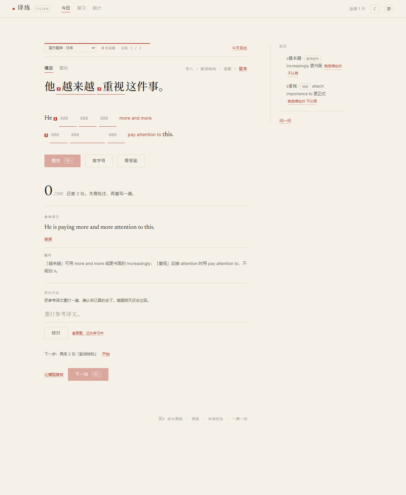
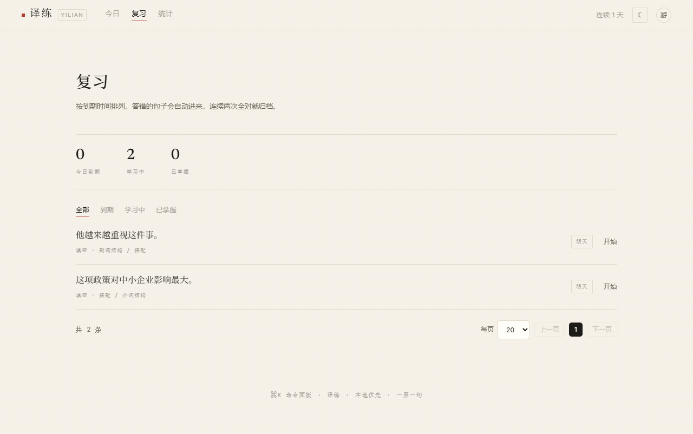
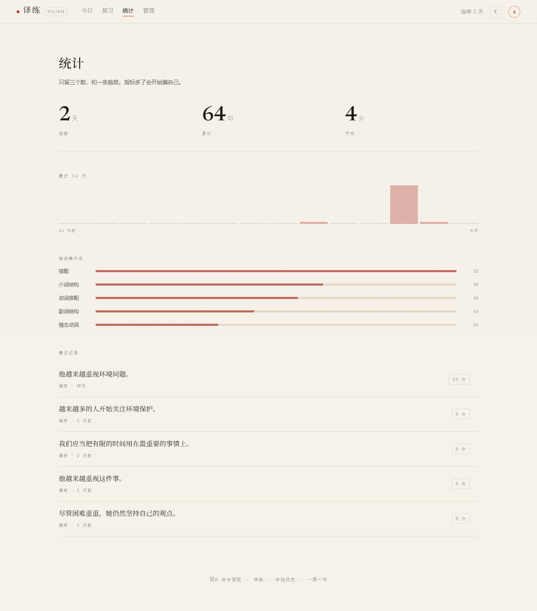
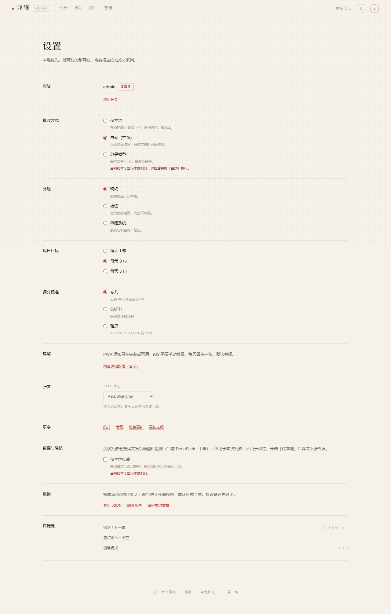
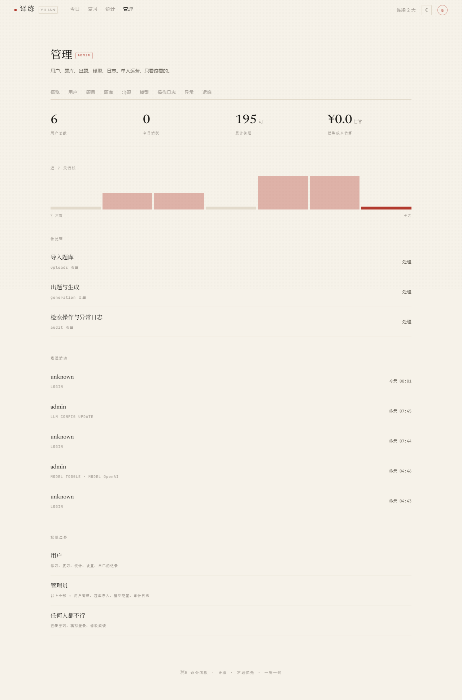
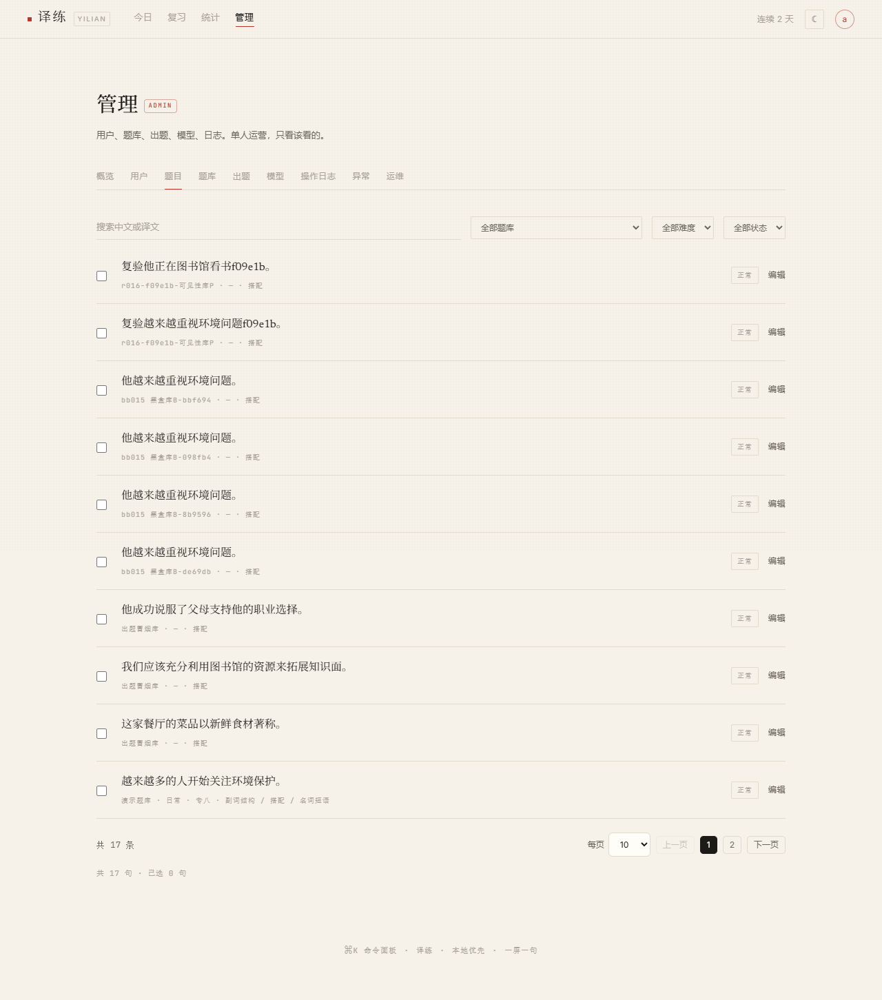
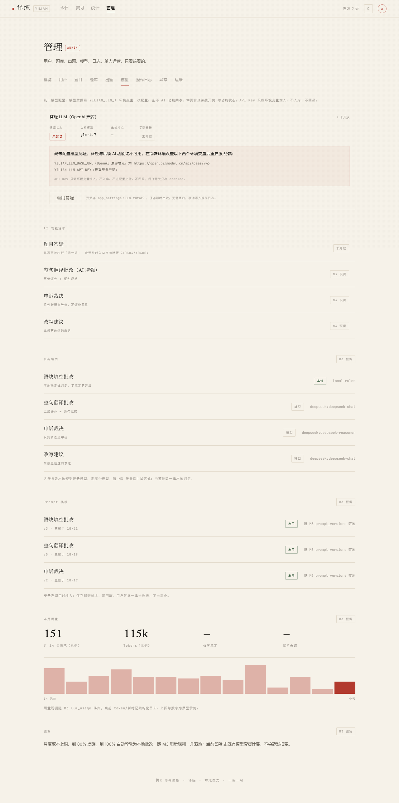

# 译练（Yilian）

> 面向中文母语者的**中译英刻意练习** PWA：一屏一句，语块填空或整句翻译，即时批改，错题复习。

## 产品截图

截于本机真实运行实例（真实模式：Spring Boot 后端 + MySQL/Redis，1280×800 视口）。

**学习者**

| 今日启动台 | 练习批改（批注区 · 考点标签 · 改对才过） |
|---|---|
|  |  |

| 复习队列 | 练习统计 |
|---|---|
|  |  |

| 学习设置 | |
|---|---|
|  | |

**管理端**（`/admin`，仅管理员）

| 运营概览 | 题目管理 |
|---|---|
|  |  |

| 统一模型配置状态中心（019） | |
|---|---|
|  | |

## 特性

**真实可用**

- 三题定级：首次打开即可测，可跳过，不贴等级标签（「先从哪档开始，N 题后自动校准」）
- 语块填空：归一化判分、逐词下划线框、三级提示阶梯、改对才过、看答案记为学习中
- 服务端练习主链路：登录用户拉题 / 判分 / 幂等提交 / SRS 排程 / 错题本 / 复习队列 / 今日；游客同页面走本地引擎，注册后本机记录自动并入账号（guest-upgrade，≤100 条/批）
- FSRS 复习调度（M2.1）：FSRS-6 排程，管理员优化器（`/api/admin/fsrs/optimize`）以 SGD 拟合个人记忆参数；练习取题支持指定句 / 错题 / 排除 / 考点筛选（D7）
- 积压降载：到期超阈值只推 5 句，顺延可撤销、有理由
- 题目答疑 AI（017）：练习页批注栏「问一问」，针对当前句的被动一问一答（非 AI 外教），回答必带免责标注；LLM 凭据双通道（027B 起）——环境变量 `YILIAN_LLM_*` 注入，或管理端「模型」页录入后 AES-256-GCM 加密入库（密文不回显、不进日志；**部署需设置主密钥环境变量 `YILIAN_SECRET_MASTER_KEY`，prod 缺失启动失败**）；022 起 provider 目录支持三协议、028 起答疑端点/模型/密钥在管理端全字段可编辑、保存即时生效；三态：未配置功能不存在（40400）/ 未开启（40304）/ 开启可用
- AI 增强（024/025）：模型复核——已判分提交追加 `grader=MODEL` 判分行（一人一次幂等回读、不覆盖首判、不影响复习排程、限流 5 次/分钟）；申诉两级裁决——提交即同步 LLM 初裁（不可用时占位不阻塞）+ 管理端人工终审，终审通过的可接受答案进判分 overlay（不物理改题目）；三条同步 LLM 链路失败全部固定文案降级，主链路不阻塞
- 统计：连续天数、累计句数、14 天趋势、错误考点 Top5
- 离线：断网续练、草稿自动保存、联网自动补交离线答卷
- 账号：邀请码注册、双 token 认证（access 内存 15 分钟 + refresh 会话 JDBC）、改密、一次性重置密码、删除账号；登出/改密/降级吊销全部 refresh 会话
- 管理端（真实接口）：概览、用户与邀请码管理、题库/题目管理与批量操作、导入 preview→commit、操作日志与异常日志检索、FSRS 优化
- 防护：登录与匿名读限流（429 带 Retry-After）、幂等以数据库唯一约束兜底、安全响应头（CSP/HSTS 等）、最后管理员锁、题库元数据 L1 缓存（击穿/穿透/雪崩三防护）

**演示/预留态**（mock 数据或计划标注预留，代码带 `TODO(mock)` 标记）

- 管理端模型页签：统一模型配置状态卡已真实（019 AC-1，LLM 凭证状态 / 答疑启停 / 功能清单联动）；Prompt 登记已随 V13 `prompt_versions` 注册表落地（ask/review/appeal 三链路系统提示按 ACTIVE 版本取用，缺行回退代码常量），**034 起 Prompt 版本写路径/管理入口/激活换轨与黄金集回归门禁已建**（管理端「模型」页签 Prompt 模板区块：登记候选版本/激活换轨，见 [docs/API.md](docs/API.md) §8.18）；用量落库已随 V11 `llm_usage` 落地；**任务路由仍为 M3 预留示意**
- 深度批改（M3）：整句模式当前仅本地要点覆盖粗判，不调模型

## 快速开始

**路径 A · 演示模式**（不需要后端与数据库，全部演示数据）

```powershell
pnpm --dir web install
$env:VITE_USE_MOCK="true"; pnpm --dir web dev
```

**路径 B · 完整启动**（需要本机 MySQL 8 + Redis；前置工具与首次配置见 [docs/BOOTSTRAP.md](docs/BOOTSTRAP.md)）

```powershell
# 后端（必须显式 local profile，凭据在 server/config/application-local.yml，
# 新机器先从 application-local.yml.example 复制并改本机 MySQL 口令）
cd server
.\mvnw.cmd spring-boot:run "-Dspring-boot.run.profiles=local" "-Dspring-boot.run.arguments=--spring.config.additional-location=optional:file:./config/"

# 前端（另开终端）
pnpm --dir web install
pnpm --dir web dev
```

- 后端 <http://localhost:8080> · 前端 <http://localhost:5173>
- local 管理员默认 `admin / change-me-now`（仅本机；prod 未设置环境变量或仍为默认值时**启动直接失败**，忘记密码用一次性 `reset-password-on-startup`，见 [docs/BOOTSTRAP.md](docs/BOOTSTRAP.md) §3）
- 游客不登录即可练习；数据存本机 IndexedDB，不上传
- 答疑/复核/申诉初裁三条 LLM 链路默认关闭：环境变量与管理端加密入库两路都未配置时功能不存在（前端无入口）；配置后在管理端「模型」页签开启/录入——密钥加密入库需先设置 `YILIAN_SECRET_MASTER_KEY`（prod 未设置或仍为占位值时启动直接失败）

## 使用说明

- **游客与账号**：游客数据只存本机（全链路零网络写请求）；登录/注册后本机练习记录自动并入账号（guest-upgrade），失败可在设置页「同步本地记录到账号」重试。登录用户的练习/统计/复习由服务端承担，游客由本地引擎承担（同页面双模式）。
- **离线行为**：页面已打开时断网可继续作答（本地队列 + 本地判分），联网后自动补交；整页离线冷启动暂不支持。
- **管理端**：顶栏「管理」进入（仅管理员，与主界面同一壳层）；真实模式下覆盖运营核心域。模型页签自 019 起为统一模型配置状态中心：LLM 凭证状态、答疑启停与 AI 功能清单联动为真实数据；027B 起支持 provider API 密钥加密录入（写-only，只显尾号），028 起答疑端点/模型/密钥全字段可编辑；仅任务路由仍为预留示意（Prompt 登记与用量落库已落地）。025 起管理端另有「申诉」页签（两级裁决终审）。
- **提交/下一句**快捷键：`Ctrl/⌘ + Enter`；模式切换：`1 / 2`。

## 架构概览

```
web/src/  （@yilian/web，React PWA）
├─ app/            # TanStack Router（壳层布局、定级门、管理门）
├─ features/       # 按领域分目录（today/practice/review/stats/settings/placement/admin/...）
├─ lib/
│  ├─ api.ts       # 请求分发：mock → 本地引擎 → 真实后端（三层适配，LOCAL_ROUTE_GROUPS 一处切换）
│  ├─ local-engine/ # 本地练习引擎（判分/SRS/统计/离线队列，IndexedDB 持久化）
│  └─ schemas/     # Zod 契约（与 docs/API.md 对齐）
└─ mocks/          # 演示数据层（VITE_USE_MOCK 控制）

server/src/main/java/io/github/codejinxz/yilian/  （yilian-server，Spring Boot 4.1 + Java 21）
├─ auth/ content/ practice/ system/ upload/ admin/  # 业务模块（controller → service → dao）
└─ common/          # ApiResponse 信封、双 token 安全、审计 AOP、限流、幂等、缓存、error_log
```

数据访问三层适配是核心设计：mock（演示）/ 本地引擎（游客与离线）/ 服务端共用同一套页面与 Zod 契约，
切换只改 `lib/api.ts` 的 `LOCAL_ROUTE_GROUPS` 开关。持久层 Spring Data JPA 负责写与单表 CRUD，
MyBatis 负责复杂查询与统计；判分 append-only，答题记录绑定判分版本。

## 测试与质量

```powershell
.\server\mvnw.cmd test        # 后端全量：单测 + 真实 MySQL 集成测试（独立库 yilian_test，不用 Docker、不 skip）
pnpm --dir web test           # vitest
pnpm --dir web build          # 含 tsc --noEmit
pnpm --dir web biome:check    # 前端 lint
```

- **测试口令三层口径**（016 裁决，详见 [docs/BOOTSTRAP.md](docs/BOOTSTRAP.md) §5）：本机缺省回落文档化 dev 默认值 `root / 123456`（即开即测，非机密）；开发者可用 `YILIAN_TEST_DB_*` 环境变量覆盖；CI 必须注入每次运行的随机口令。dev 默认值仅限本机，禁止复用到共享/生产环境。
- **黑盒套件**：`docs/analysis/api-test-015/blackbox-runner.py`（本机工作流资产，未入库）对 8080 真实后端跑 304 条全 API 用例；另有 JMeter 性能基线（015 波次，虚拟线程已因 P0 崩溃关闭）。
- **集成测试**：登录 → 拉题 → 提交 → 批改端到端主链路有真实 HTTP 集成测试（016 DoD）；后端另有 JaCoCo 覆盖率门禁（LINE ≥ 85 / BRANCH ≥ 65，报告在 `target/site/jacoco/`），前端 `pnpm --dir web test:coverage`。

CI（`.github/workflows/ci.yml`）在 push 与 PR 时自动执行后端测试与 google-java-format 校验、前端构建/测试与 biome 校验。

### SOP：换模型 / 改 Prompt 前必跑黄金集（034）

黄金集是分层回归资产（`server/src/test/resources/golden/`）：grading 层 31 条**确定性**用例（精确对拍本地判分主链，CI 常跑）+ review/appeal/ask 三层 LLM 用例（25/26/12 条，**只锁结构与方向约束，不锁逐字文本**——LLM 非确定性，预披露裁决；结论是「结构合规 + 方向一致」而非「语义完全等价」，SOP 如实写明该边界）。换模型、改 Prompt（登记/激活新版本）前，按以下两步执行并把结果记入本次变更的收口记录：

**第 1 步 · grading 层（CI 已含，本地复跑确认）：**

```powershell
cd server
YILIAN_TEST_DB_NAME=yilian_test_034 ./mvnw.cmd test "-Dtest=GoldenGradingSetTest"
```

期望输出尾行：`Tests run: 31, Failures: 0, Errors: 0, Skipped: 0`（BUILD SUCCESS）。任何一条红=本地判分语义漂移，先修再上线。

**第 2 步 · LLM 三层（真实网关，需本机 ZCode 网关可达）：**

```powershell
cd server
YILIAN_TEST_DB_NAME=yilian_test_034 ./mvnw.cmd test "-Dtest=GoldenLlmSetTest" "-Dgolden.enabled=true"
```

期望输出尾行：`Tests run: 63, Failures: 0, Errors: 0`（review 25 + appeal 26 + ask 12，BUILD SUCCESS）。双闸说明：未加 `-Dgolden.enabled=true` 或网关不可达（无可用客户端/探活失败）时整套件按 Assumptions 跳过（`Tests run: 0`），这是 CI 默认形态而非运行成功——**跳过 ≠ 通过**，第 2 步的结果必须实际跑出数字才算数。已知边界：网关不生效 top-level `system` 字段时 review/appeal 的 strict JSON 解析会失败（GAP 029 DEF-01 依赖侧登记），这正是黄金集要暴露的回归，出现时按用例 id 记录、走 DEF-01 修复方向而非放宽断言。

结果记录位置：变更的收口记录（GAP-ANALYSIS 当前状态行或对应 PR 文档）写明四层各自「通过条数 / 总条数 / 失败用例 id / 网关与模型名快照」。

## 里程碑状态

| 计划 | 内容 | 状态 |
|---|---|---|
| 010 | 管理端并回主壳层（AdminLayout 拆框架，九页签落 AppShell） | ✅ 已收口 |
| 011 | 管理端真实接口切片：概览 / 用户 / 邀请码 / 题库题目管理 | ✅ 已收口 |
| 012 | 管理端收尾：日志检索端点 / 出题导入 / 熔断遗留 | ✅ 已收口 |
| 013 | 防护缺口批次：幂等定时清理 / 题库 L1 缓存三防护 / 安全响应头 / 最后管理员锁 | ✅ 已收口 |
| 014 | M2.1：FSRS 优化器（SGD 拟合权重）+ D7 取题四参数 | ✅ 已收口 |
| 015 | 全量 API 测试：黑盒 304 用例 + JMeter 性能基线 + 白盒审查 | ✅ 已收口 |
| 016 | 外部评审消化：112 条 P0/P1 修复、P2 择要、端到端集成测试 | ✅ 已收口 |
| 017 | 题目答疑 AI 机器人（管理员启停，OpenAI 兼容协议接智谱套餐） | ✅ 已收口（2026-11-04） |
| 018 | 二轮评审修复 + 原型小项批次 + 重置密码与删除账号端点 | ✅ 已收口（2026-11-04） |
| 019 | 统一模型配置状态中心（ModelsPage 状态卡 + 答疑联动） | ✅ 已收口（2026-11-05） |
| 020 | 练习选题功能：题库句列表端点 + 练习页选题面板 | ✅ 已收口（2026-11-05） |
| 021 | LLM provider 抽象 + ZCode 本地网关适配（anthropic 协议轨） | ✅ 已收口（2026-11-05） |
| 022 | AI 配置升级：CC Switch 式 provider 目录 + 三协议 + 答疑 Markdown 渲染 | ✅ 已收口（2026-11-05） |
| 023 | 全仓双 skill consolidation 修复批：挂起 P2×4/DEF 缺陷修复 + JWT 过期反向测试 + 黑盒期望同步 + 文档四断点收口 | ✅ 已收口（2026-11-05） |
| 024 | 模型复核接后端：`grader=MODEL` 判分行追加 + 幂等回读 + 限流 + 排程隔离 + 35s 超时 | ✅ 已收口（2026-11-06） |
| 025 | 申诉 LLM 裁决两级闭环：同步 AI 初裁 + 管理端终审 + 判分 overlay + V13 Prompt 注册表 | ✅ 已收口（2026-11-06） |
| 026 | 管理页错误态 admin 变体收口 + 死查询清理 | ✅ 已收口（2026-11-06） |
| 027 | 统一模型配置动态化（provider 全字段编辑）+ 体验修正合并批 | ✅ 已收口（2026-11-06） |
| 027B | provider API 密钥管理端加密入库（AES-256-GCM，`YILIAN_SECRET_MASTER_KEY`，prod fail-fast） | ✅ 已收口（2026-11-17） |
| 028 | 答疑 LLM legacy 态全字段可编辑（覆盖轨 + 来源徽标 + 即时生效） | ✅ 已收口（2026-11-17） |

计划全文在 `docs/plans/`（本机工作流资产，未入库）；变更摘要见 [CHANGELOG.md](CHANGELOG.md)。

## 已知限制

- 深度批改（M3）未接入：整句模式仅本地要点覆盖粗判；任务路由仍为预留示意（统一模型配置状态中心已落地，019 AC-1；Prompt 版本登记 V13 与用量落库 V11 已落地，prompt 版本写路径/回归门禁未建，见 GAP 登记）
- 2FA 未启用（公网部署前置项，见 [AGENTS.md](AGENTS.md) §3.7）
- 外部评审 P2/P3 backlog 尚未消化完（登记于 `docs/analysis/review-p2-backlog.md`，本机资产）
- PWA 离线增强（更新提示、iOS 存储持久化）在 P1 队列

## FAQ

**为什么游客不用注册？** 产品原则「本地优先」：游客数据只存本机，注册是为了跨设备与长期留存；注册/登录时通过 guest-upgrade 把本机记录自动迁入账号（已实现）。

**定级为什么没有等级标签？** 产品红线：只给起点与「N 题后自动校准」，避免标签焦虑。

**答疑 AI 会拿我的译文去训练吗？** 不会。答疑上下文只含题目中文、考点与本人最近批注，不含参考译文；模型调用仅本次批改/答疑有效，不用于训练（见 [docs/API.md](docs/API.md) §6.12）。

**JSON 日志在哪里？** 仅 prod 输出结构化 JSON（含 `traceId`、脱敏 `userId`，供采集器解析）；local 控制台是人类可读格式。

**答题记录可以改吗？** 判分 append-only：`attempts` 绑定 normalizer / rubric / prompt / model 版本，改判写新记录，不原地覆盖。

## 贡献

见 [CONTRIBUTING.md](CONTRIBUTING.md)。安全类问题见 [SECURITY.md](SECURITY.md)。

## 文档

| 文档 | 内容 |
|---|---|
| [AGENTS.md](AGENTS.md) | 项目契约：规范、完成定义、禁止事项（先读） |
| [docs/PRD.md](docs/PRD.md) | 产品需求与验收标准 |
| [docs/API.md](docs/API.md) | 接口契约 + §10 实现状态矩阵 |
| [docs/DATA-MODEL.md](docs/DATA-MODEL.md) | 数据模型与迁移约定 |
| [docs/RESEARCH.md](docs/RESEARCH.md) | 设计决策（教学法/架构取舍） |
| [docs/GAP-ANALYSIS.md](docs/GAP-ANALYSIS.md) | 待办与优先级、当前状态 |
| [docs/BOOTSTRAP.md](docs/BOOTSTRAP.md) | 新机从零启动手册（含测试口令三层口径） |
| [docs/ACCEPTANCE.md](docs/ACCEPTANCE.md) | 验收与手工检查清单 |
| [docs/NAMING.md](docs/NAMING.md) | 命名与工程结构 |
| [docs/WORKFLOW-PROMPTS.md](docs/WORKFLOW-PROMPTS.md) | 六阶段流程与门禁 |
| [docs/练习主链路_切片设计.md](docs/练习主链路_切片设计.md) | 练习主链路切片历史执行稿（波次一~四已收口） |
| [docs/中译英刻意练习_调研结论.md](docs/中译英刻意练习_调研结论.md) | 教学法原始调研 |
| [docs/analysis/arch-review-20261104.md](docs/analysis/arch-review-20261104.md) | 架构评审（2026-11-04；本机分析资产，未入库） |
| [CHANGELOG.md](CHANGELOG.md) | 面向使用者的变更摘要 |

## 许可证

[MIT](LICENSE)
