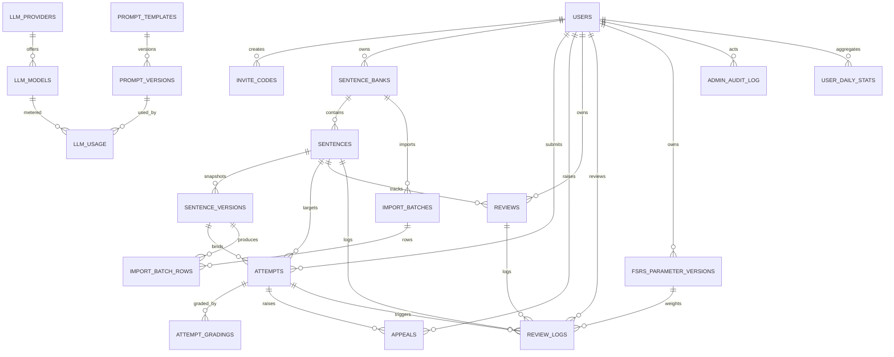

# 译练 · 数据模型（V1 / M1 + M2）

| 项 | 内容 |
|---|---|
| 版本 | v0.4（028 答疑 LLM 覆盖配置 llm.tutor 扩展 + llm_provider_keys 预留 id=tutor） |
| 日期 | 2026-11-17 |
| 状态 | 待产品/技术负责人确认后冻结 |
| 上游 | `AGENTS.md`、`docs/PRD.md` §5/§8/§11/§16/§17/§18、`docs/NAMING.md`、`docs/GAP-ANALYSIS.md` |
| 下游 | `docs/API.md`（未开始）、`docs/openapi.yaml`（M1/M2 实现后导出） |

> 本文件是字段的唯一来源。`docs/API.md`、`openapi.yaml`、前端类型只能从这里取字段；发现字段不够用，先改本文件并追加变更记录，再改接口。
>
> 本文件不写可执行 DDL。表结构以「字段 / 类型 / 可空 / 默认值 / 说明」描述，迁移文件按 §12 的顺序落地。

---

## 1. 本次范围与关键结论

### 1.1 范围

- M1：账号、登录会话、邀请码、题库与句子版本、导入预览/提交/批次、操作日志、异常日志、系统配置。
- M2：拉题、填空/整句 attempt 提交、判分、错题、FSRS 复习队列、申诉记录。
- M3 预留、本次不建：模型目录、Prompt 版本、LLM 用量、统计聚合。
- 不做：三题定级、积压熔断/顺延、排行榜、打卡、UGC、模型生成题库。

### 1.2 已冻结的结论

1. `attempts` 只存一次提交；`attempt_gradings` 存每次判分/复核/改判；两者都 append-only。  
2. 同一 `attemptId` 重复提交返回已有结果；同一 ID 但载荷不同返回 409；游客只落本地。  
3. `sentences` 存题目身份/当前版本指针/银行级修订号；`sentence_versions` 存不可变内容。  
4. 导入按 PRD 重建：预览 → 提交 → 批次查询/回滚；旧异步 `import_batch`（上传→PROCESSING→resume）已删除，实体对齐 `import_batches`/`import_batch_rows`。  
5. 复习采用完整 FSRS：四档评分、期望保留率、参数版本与优化记录；UI 仍显示 `新题 / 学习中 / 已掌握`。  
6. 所有时间戳 UTC；到期用 `DATETIME`，不用 `DATE`；日界按用户 IANA 时区计算。  
7. 软删统一 `deleted_at` / `deleted_by`；`enabled` 只表示账号启停，不表示删除。  
8. 迁移不使用 `out-of-order`；测试库可重置，生产库禁止手改历史迁移。  

### 1.3 与 PRD §8 的差异

| PRD 表 | 差异 | 原因 |
|---|---|---|
| `users` | 改名 `users`（原实现 `app_user`）；补时区、每日目标、评分标准、期望保留率、停用原因、软删、首次改密 | 账号要跨设备、时区日界和 FSRS 设置 |
| `sentence_banks` | 补生命周期状态、软删、银行级版本游标 | 支持发布/停用/回收站与增量拉取 |
| `sentences` | 拆成 `sentences` + `sentence_versions` | 改题不能覆盖历史，attempt 必须能回放旧版本 |
| `attempts` | 拆成 `attempts` + `attempt_gradings`；`answer` 改 JSON | 复核/改判 append-only，填空需要逐槽结构 |
| `reviews` | 改为 FSRS 投影；`due` 改 `due_at`；补稳定性/难度/评分/参数版本 | 完整 FSRS 与 UTC 到期 |
| 新增 | `invite_codes`、`import_batches`、`import_batch_rows`、`appeals`、`review_logs`、`fsrs_parameter_versions`、`admin_audit_log`、`error_log`、`app_settings` | PRD §16–§18、GAP P0、FSRS |

---

## 2. 实体清单

| 域 | 实体 | 来源 | 本次 |
|---|---|---|---|
| account | `users` | PRD §8 | M1 |
| account | `invite_codes` | PRD §16 | M1 |
| account | `user_2fa_recovery_codes` | 新增（2FA 恢复码投影） | **V15 已建**（§5.21，内部表无端点） |
| content | `sentence_banks` | PRD §8 | M1 |
| content | `sentences` | PRD §8 | M1 |
| content | `sentence_versions` | 新增（从 sentences 拆出） | M1 |
| content | `import_batches` | PRD §16 | M1 |
| content | `import_batch_rows` | 新增（逐行原因） | M1 |
| practice | `attempts` | PRD §8 | M2 |
| practice | `attempt_gradings` | 新增（从 attempts 拆出） | M2 |
| practice | `appeals` | PRD §5.1 / §16 | M2（记录/排除；LLM 裁决 M3） |
| practice | `reviews` | PRD §8 | M2 |
| practice | `review_logs` | 新增（FSRS 复习日志） | M2 |
| practice | `fsrs_parameter_versions` | 新增（FSRS 参数版本） | M2 |
| admin | `admin_audit_log` | PRD §18.1 | M1 |
| admin | `error_log` | PRD §18.2 | M1 |
| system | `app_settings` | PRD §17 | M1（只读配置；编辑 M3） |
| analytics | `user_daily_stats` | PRD §16 | M3 预留，不建 |
| ai | `llm_usage` | PRD §17 | **V11 已建**（§5.18，append-only 用量账本，内部表无端点；V16 补估算成本列） |
| ai | `llm_provider_keys` | PRD §17（provider 密钥管理） | **V14 已建**（§5.20，密钥投影表，内部表无端点） |
| ai | `llm_providers` / `llm_models` / `prompt_templates` / `prompt_versions` | PRD §17 | M3 预留，不建 |

基础设施表（不属于业务实体，但属于最终 schema）：

- `spring_session` / `spring_session_attributes`：Spring Session JDBC 的 refresh 会话；V1 已有，保留。
- `idempotency_record`：通用幂等兜底表，`JdbcIdempotencyService` 依赖。列集
  `owner_id VARCHAR(64)` / `scope VARCHAR(64)` / `idempotency_key VARCHAR(191)` / `request_hash VARCHAR(64)` /
  `created_at` / `expires_at`，唯一键 `(owner_id, scope, idempotency_key)`（V4 建表、V5 补 owner 归属修复）。
  attempts 的幂等以自身主键为准，不经此表（D-018）。
- `flyway_schema_history`：Flyway 自动维护。

**明确不建**：

| 候选 | 结论 | 理由 |
|---|---|---|
| `auth_sessions` | 不建 | 新 AGENTS 已定 refresh 用 Spring Session JDBC，不重复建会话表 |
| `user_settings` | 不建 | 设置字段少，直接放 `users` |
| `practice_sessions` | 不建 | 题数/正确率/连续天数由 attempts + 用户时区派生 |
| `sentence_answer_variants` | 不建 | 已接受申诉作为 `appeals` overlay 参与判分，不物理改题目 |
| `content_changes` | 不建 | 用 `sentences.version` 银行级游标 + `sentence_versions` 快照 |
| `question_stats` | 暂不建 | 坏题探测到 M3 有真实数据后再加 |
| `fsrs_optimization_runs` | 不建 | 优化结果写 `fsrs_parameter_versions`，失败进 `error_log` |
| `operation_log` | 改名 | 统一为 PRD §18.1 的 `admin_audit_log` |
| `import_batch` | 改名/重建 | 统一为 `import_batches` + `import_batch_rows` |

---

## 3. 关系图



`APP_SETTINGS`、`ERROR_LOG` 为独立表；`LLM_*` 为 M3 预留，不随 M1/M2 建。

---

## 4. 通用约定

### 4.1 命名与类型

- 表名、列名用 `snake_case`；表名用复数（历史 `error_log` 除外，沿用 PRD）。
- 主键：业务内部 ID 用 `BIGINT AUTO_INCREMENT`；客户端提交的 attempt 用 `CHAR(36)` UUID；句子用 `CHAR(26)` ULID。
- 对外 JSON 中所有 `BIGINT` ID 一律序列化为字符串，避免 JS 精度问题；`attemptId` 保持 UUID 字符串。
- 字符串统一 `utf8mb4` / `utf8mb4_0900_ai_ci`。
- 布尔用 `BOOLEAN`（MySQL `TINYINT(1)`）；历史 `BIT(1)` 表在迁移时统一。
- 金额用 `DECIMAL(12,6)`；比例用 `DECIMAL(4,3)`。
- 时间用 `DATETIME(6)`，按 UTC 写入；禁止 `TIMESTAMP`（会受服务器/会话时区影响）。

### 4.2 审计字段

| 字段 | 规则 |
|---|---|
| `created_at` | 所有表都有（除纯关联表）；UTC |
| `updated_at` | 可变表才有；append-only 表没有 |
| `created_by` / `updated_by` | 管理端写入或需要追溯的表才有；存 `users.id` |
| `deleted_at` / `deleted_by` | 可软删表才有；`NULL` 表示未删 |
| `enabled` | 只用于账号/邀请码/配置的启停，不等于删除 |
| `status` | 内容生命周期；回收站 = `RECYCLED` + `deleted_at` 非空 |

### 4.3 只增不改

以下表禁止应用层 UPDATE/DELETE，迁移中加 `BEFORE UPDATE` / `BEFORE DELETE` 触发器（`SIGNAL SQLSTATE '45000'`）：

- `sentence_versions`
- `attempts`
- `attempt_gradings`
- `review_logs`
- `admin_audit_log`（UPDATE 禁止；保留期通过月分区 DROP 清理，不按行 DELETE）
- `error_log`（同上）

`reviews`、`appeals`、`import_batches`、`import_batch_rows`、`users`、`sentences`、`sentence_banks`、`prompt_versions`（label 流转；行内容 name/version/content 不改写）、`llm_provider_keys`（027B 密钥投影：录入即 upsert 覆盖密文、目录删除即删行，变更经管理端 `@OperationLog` 审计留痕）是可变投影/状态表，允许受控 UPDATE/DELETE；其余变更必须写 `admin_audit_log` 或 `review_logs`。

### 4.4 时区与日界

- 所有 `DATETIME` 存 UTC。
- `users.timezone` 存 IANA 时区（如 `Asia/Shanghai`）。
- “今天到期/今日已练”按 `LocalDate.now(ZoneId.of(users.timezone))` 计算本地日界，再转成 UTC 区间查询。
- `reviews.due_at` 用 `DATETIME(6)` UTC，不用 `DATE`。原因：跨时区/夏令时下 DATE 无法表达“下一次到期瞬间”，且 PRD 的“今日”是用户本地概念。
- `user_daily_stats.stat_date` 是唯一使用 `DATE` 的业务列，表示用户本地日期；同时快照 `timezone`。

### 4.5 逻辑外键约定

> **V10 起物理外键全部移除**（`V10__drop_fks_index_tuning.sql`）：下表是**逻辑外键清单**——关系由应用层在写路径校验存在性与归属，普通索引支撑查询；唯一约束（uk_*）、CHECK 约束、触发器、分区全部保留，幂等与去重语义由唯一索引兜底。删 FK 的动机与 EXPLAIN 证据见 `docs/analysis/db-review-20261031.md`（本地评审文档，不入库）；逐条 FK 的「应用层校验位置」审计表见同文档 §6.1。InnoDB 删 FK 后原支撑索引保留为普通索引，查询计划不受影响。

| 子表.列 | 父表.列 | 原约束 | 说明 |
|---|---|---|---|
| `sentence_banks.owner_id` | `users.id` | RESTRICT | NULL = 官方；当前无运行时建库入口，加写入口时必须校验 owner 存在 |
| `sentences.bank_id` | `sentence_banks.id` | RESTRICT | 题目不脱离题库；`importSentences` 校验 bank 存在且未删、可导入 |
| `sentences.current_version_id` | `sentence_versions.id` | RESTRICT | 插入时先 NULL，同事务回填到刚落库的版本（构造性保证） |
| `sentence_versions.sentence_id` | `sentences.id` | RESTRICT | 快照永不删；引用同事务刚建的题目（构造性保证） |
| `sentence_versions.bank_id` | `sentence_banks.id` | RESTRICT | 冗余校验，复用 bank 校验 |
| `sentence_versions.import_batch_id` | `import_batches.id` | RESTRICT | 批次不硬删；传入已加载的批次实体 id |
| `import_batches.bank_id` | `sentence_banks.id` | RESTRICT | 导入目标；`isImportableBank` 校验 |
| `import_batches.created_by` | `users.id` | RESTRICT | 另存 `created_by_name` 快照；来自 JWT 认证主体 |
| `import_batch_rows.batch_id` | `import_batches.id` | RESTRICT | 批次不硬删；与批次同事务同 id（构造性保证） |
| `import_batch_rows.sentence_id` | `sentences.id` | RESTRICT | 成功后关联；写 importSentences 返回值（构造性保证） |
| `import_batch_rows.sentence_version_id` | `sentence_versions.id` | RESTRICT | 成功后关联；同上 |
| `attempts.user_id` | `users.id` | RESTRICT | 游客不落库；来自认证主体 |
| `attempts.sentence_id` | `sentences.id` | RESTRICT | 题目标识；`requirePracticeableSentence` 校验 |
| `attempts.sentence_version_id` | `sentence_versions.id` | RESTRICT | 内容快照；与当前版本一致性比对 |
| `attempts.retry_of_id` | `attempts.id` | RESTRICT | 自关联；`validateRetryChain` 校验同用户同题同模式 |
| `attempt_gradings.attempt_id` | `attempts.id` | RESTRICT | 判分不脱离提交；引用同事务刚落的提交（构造性保证） |
| `appeals.attempt_id` | `attempts.id` | RESTRICT | 申诉不脱离提交；findById + 归属校验 |
| `appeals.user_id` | `users.id` | RESTRICT | 申诉人；来自认证主体 |
| `appeals.sentence_id` | `sentences.id` | RESTRICT | overlay 查询；取自已落库提交的合法引用 |
| `reviews.user_id` | `users.id` | RESTRICT | 用户卡；来自认证主体 |
| `reviews.sentence_id` | `sentences.id` | RESTRICT | 题目卡；同 attempt.sentence_id 校验 |
| `review_logs.review_id` | `reviews.id` | RESTRICT | 复习日志；引用已加载/刚建的卡（构造性保证） |
| `review_logs.user_id` | `users.id` | RESTRICT | 用户；来自认证主体 |
| `review_logs.sentence_id` | `sentences.id` | RESTRICT | 题目；同 attempt.sentence_id |
| `review_logs.attempt_id` | `attempts.id` | RESTRICT | 触发提交；构造性保证 |
| `review_logs.weights_version_id` | `fsrs_parameter_versions.id` | RESTRICT | 参数版本；`findActiveGlobalId` 存在性校验 |
| `fsrs_parameter_versions.user_id` | `users.id` | RESTRICT | 仅 USER owner；当前仅 V9 种子 GLOBAL 行，无运行时写入口 |
| `admin_audit_log.actor_id` | `users.id` | （无物理外键，分区表） | 保留 `actor_name` 快照 |
| `error_log.user_id` | `users.id` | （无物理外键，分区表） | 保留 `operator` 快照 |
| `user_daily_stats.user_id` | `users.id` | RESTRICT | 聚合表（M3 预留，未建） |

**禁止**：硬删任何父表行制造孤儿引用；答题链路（`attempts`/`attempt_gradings`/`review_logs`/`reviews`）永远不允许 `ON DELETE CASCADE` 语义（含应用层联删）。

---

## 5. 表结构

> 可空列用 `NULL` 标注；未标 `NULL` 的均为 `NOT NULL`。默认值只写业务默认，不写数据库引擎默认（迁移中再落 `DEFAULT`）。

### 5.1 `users`

| 字段 | 类型 | 可空 | 默认 | 说明 |
|---|---|---|---|---|
| `id` | BIGINT | 否 | AUTO | 主键 |
| `email` | VARCHAR(255) | 是 | NULL | 登录/通知；唯一；删号 30 天后匿名化 |
| `username` | VARCHAR(64) | 否 | — | 唯一登录名/展示名 |
| `password_hash` | VARCHAR(255) | 否 | — | BCrypt 现在；Argon2id 预留长度 |
| `role` | VARCHAR(16) | 否 | `USER` | `USER` / `ADMIN` |
| `enabled` | BOOLEAN | 否 | `TRUE` | 账号启停；停用立即吊销 refresh 会话 |
| `password_changed` | BOOLEAN | 否 | `FALSE` | 首次登录是否已改密 |
| `password_updated_at` | DATETIME(6) | 是 | NULL | 最近改密时间 |
| `timezone` | VARCHAR(64) | 否 | `Asia/Shanghai` | IANA 时区 |
| `daily_goal` | SMALLINT | 否 | `3` | 1 / 3 / 5 |
| `rating_standard` | VARCHAR(16) | 否 | `TEM8` | `TEM8` / `CATTI` / `IELTS` |
| `desired_retention` | DECIMAL(4,3) | 否 | `0.900` | FSRS 期望保留率，0.800–0.970 |
| `theme` | VARCHAR(8) | 否 | `paper` | `paper` / `night`；前端也可本地覆盖 |
| `notifications_enabled` | BOOLEAN | 否 | `FALSE` | 通知默认关闭 |
| `totp_secret_cipher` | VARCHAR(512) | 是 | NULL | TOTP 密钥密文（032）：SecretCipher AES-256-GCM（主密钥 `YILIAN_SECRET_MASTER_KEY`），列上无明文；未 setup 为 NULL |
| `totp_enabled` | BOOLEAN | 否 | `FALSE` | 登录第二步开关（032）：activate 后 TRUE，disable/reset-2fa 清回 FALSE |
| `totp_enrolled_at` | DATETIME(6) | 是 | NULL | 2FA 启用时刻（032）；未启用 NULL |
| `last_login_at` | DATETIME(6) | 是 | NULL | 最近登录成功 |
| `disabled_reason` | VARCHAR(255) | 是 | NULL | 停用原因，管理员必填 |
| `disabled_at` | DATETIME(6) | 是 | NULL | 停用时间 |
| `deleted_at` | DATETIME(6) | 是 | NULL | 软删；30 天后匿名化 |
| `deleted_by` | BIGINT | 是 | NULL | 操作者 |
| `created_at` | DATETIME(6) | 否 | — | UTC |
| `updated_at` | DATETIME(6) | 否 | — | UTC |

索引/约束：

- 主键 `(id)`
- 唯一 `uk_users_email (email)`
- 唯一 `uk_users_username (username)`
- 普通 `idx_users_role_enabled (role, enabled)`
- 普通 `idx_users_deleted_at (deleted_at)`

软删：`deleted_at` / `deleted_by`。`enabled=FALSE` 是停用，不是删除。

### 5.2 `invite_codes`

| 字段 | 类型 | 可空 | 默认 | 说明 |
|---|---|---|---|---|
| `id` | BIGINT | 否 | AUTO | 主键 |
| `code_hash` | CHAR(64) | 否 | — | 规范化邀请码的 SHA-256；不存明文 |
| `code_prefix` | VARCHAR(12) | 否 | — | 列表展示前缀，如 `YL-AB12` |
| `max_uses` | SMALLINT | 否 | `1` | 一码一人时固定 1 |
| `used_count` | SMALLINT | 否 | `0` | 已使用次数 |
| `used_by` | BIGINT | 是 | NULL | 使用者；一码一人时唯一 |
| `used_at` | DATETIME(6) | 是 | NULL | 使用时间 |
| `expires_at` | DATETIME(6) | 是 | NULL | 过期时间；空表示不过期 |
| `enabled` | BOOLEAN | 否 | `TRUE` | 是否可继续使用 |
| `created_by` | BIGINT | 是 | NULL | 管理员 |
| `created_at` | DATETIME(6) | 否 | — | UTC |
| `deleted_at` | DATETIME(6) | 是 | NULL | 软删 |
| `deleted_by` | BIGINT | 是 | NULL | 操作者 |
| `revoked_reason` | VARCHAR(255) | 是 | NULL | 撤销原因 |

索引/约束：

- 主键 `(id)`
- 唯一 `uk_invite_code_hash (code_hash)`
- 唯一 `uk_invite_used_by (used_by)`（一码一人；`max_uses>1` 时另开批次/放开）
- 普通 `idx_invite_expires (expires_at)`

注册：事务内 `SELECT ... FOR UPDATE` 校验 hash、未过期、`used_count < max_uses`；创建用户后回写 `used_by/used_at/used_count`。

### 5.3 `sentence_banks`

| 字段 | 类型 | 可空 | 默认 | 说明 |
|---|---|---|---|---|
| `id` | BIGINT | 否 | AUTO | 主键 |
| `owner_id` | BIGINT | 是 | NULL | NULL = 官方题库 |
| `name` | VARCHAR(128) | 否 | — | 题库名 |
| `description` | VARCHAR(500) | 是 | NULL | 说明 |
| `visibility` | VARCHAR(16) | 否 | `PRIVATE` | `PUBLIC` / `PRIVATE` |
| `status` | VARCHAR(16) | 否 | `DRAFT` | `DRAFT`/`PUBLISHED`/`DISABLED`/`RECYCLED`/`ARCHIVED` |
| `version` | BIGINT | 否 | `0` | 银行级修订号；每次发布/改题/删题/恢复 +1 |
| `published_at` | DATETIME(6) | 是 | NULL | 首次/最近发布 |
| `created_by` | BIGINT | 是 | NULL | 创建者 |
| `updated_by` | BIGINT | 是 | NULL | 最近修改者 |
| `created_at` | DATETIME(6) | 否 | — | UTC |
| `updated_at` | DATETIME(6) | 否 | — | UTC |
| `deleted_at` | DATETIME(6) | 是 | NULL | 软删/回收站 |
| `deleted_by` | BIGINT | 是 | NULL | 操作者 |

索引/约束：

- 主键 `(id)`
- 普通 `idx_bank_owner_status (owner_id, status)`
- 普通 `idx_bank_visibility_status (visibility, status)`
- 普通 `idx_bank_updated (updated_at)`

软删：`deleted_at`；回收站同时 `status='RECYCLED'`。官方题库不允许删除，只可停用/归档。

### 5.4 `sentences`

| 字段 | 类型 | 可空 | 默认 | 说明 |
|---|---|---|---|---|
| `id` | CHAR(26) | 否 | — | ULID，全局唯一 |
| `bank_id` | BIGINT | 否 | — | 所属题库 |
| `external_key` | VARCHAR(64) | 是 | NULL | 导入源 id（如 `s_0001`）；同题库**活跃行**唯一（V11） |
| `status` | VARCHAR(16) | 否 | `DRAFT` | 同题库生命周期 |
| `current_version_id` | BIGINT | 是 | NULL | 指向 `sentence_versions.id`；插入时先空，同事务回填 |
| `version` | BIGINT | 否 | `0` | 银行级修订号（用于增量 `sinceVersion`） |
| `fingerprint` | CHAR(64) | 否 | — | 归一化 `zh|ref|chunks` 的 SHA-256 |
| `active_fingerprint` | CHAR(64) | 是 | 生成列 | `IF(deleted_at IS NULL, fingerprint, NULL)`；用于未删重复硬拦 |
| `active_external_key` | VARCHAR(64) | 是 | 生成列 | `IF(deleted_at IS NULL, external_key, NULL)`（V11）；未删重复硬拦与重导放行 |
| `created_by` | BIGINT | 是 | NULL | 创建者 |
| `updated_by` | BIGINT | 是 | NULL | 最近修改者 |
| `created_at` | DATETIME(6) | 否 | — | UTC |
| `updated_at` | DATETIME(6) | 否 | — | UTC |
| `deleted_at` | DATETIME(6) | 是 | NULL | 软删；删除也必须 bump `version` |
| `deleted_by` | BIGINT | 是 | NULL | 操作者 |

索引/约束：

- 主键 `(id)`
- 唯一 `uk_sentence_active_external (bank_id, active_external_key)`（V11 起替代全行唯一的
  `uk_sentence_bank_external`：回收行 `active_external_key` 为 NULL 不参与唯一性，
  批次回滚后同文件重导放行；活跃行互斥由本键 + 导入事务 `lockById` 锁承接，并发导入兜底不变）
- 唯一 `uk_sentence_bank_active_fingerprint (bank_id, active_fingerprint)`
- 普通 `idx_sentence_bank_version (bank_id, version)`（增量拉取）
- `version` 在导入提交/回滚中「每题递增」：同批次每行获得独立银行修订号（P1-1），增量分页不丢行。
- 普通 `idx_sentence_bank_status (bank_id, status, deleted_at)`
- 普通 `idx_sentence_current_version (current_version_id)`

软删：`deleted_at`；删除/停用必须 bump `version`，否则增量客户端看不到 tombstone。

### 5.5 `sentence_versions`

| 字段 | 类型 | 可空 | 默认 | 说明 |
|---|---|---|---|---|
| `id` | BIGINT | 否 | AUTO | 主键 |
| `sentence_id` | CHAR(26) | 否 | — | 题目身份 |
| `bank_id` | BIGINT | 否 | — | 冗余，便于按题库查询 |
| `version_no` | INT | 否 | — | 单题内容版本，从 1 递增 |
| `zh` | VARCHAR(255) | 否 | — | 中文原句（4–60 字） |
| `ref` | VARCHAR(512) | 否 | — | 参考译文（8–300 字符） |
| `note` | VARCHAR(1000) | 否 | — | 解析（20–300 字） |
| `chunks` | JSON | 否 | — | 语块数组，见 §6.1 |
| `blank` | JSON | 否 | — | 挖空语块下标数组，见 §6.2 |
| `tags` | JSON | 否 | — | 考点标签数组，见 §6.3 |
| `level` | VARCHAR(32) | 是 | NULL | 专八/CATTI/雅思等 |
| `source` | VARCHAR(128) | 是 | NULL | 来源 |
| `license` | VARCHAR(64) | 是 | NULL | 许可 |
| `content_hash` | CHAR(64) | 否 | — | 内容快照 SHA-256 |
| `schema_version` | SMALLINT | 否 | `1` | `chunks/blank/tags` 的结构版本 |
| `import_batch_id` | CHAR(36) | 是 | NULL | 来源批次 |
| `created_by` | BIGINT | 是 | NULL | 创建者 |
| `created_at` | DATETIME(6) | 否 | — | UTC |

索引/约束：

- 主键 `(id)`
- 唯一 `uk_sentence_version (sentence_id, version_no)`
- 普通 `idx_sentence_version_bank (bank_id, created_at)`
- 普通 `idx_sentence_version_hash (content_hash)`
- 逻辑外键 `fk_sentence_version_sentence (sentence_id) -> sentences(id)`；`fk_sentence_version_batch (import_batch_id) -> import_batches(id)`（V10 起由应用层校验 + 普通索引支撑，见 §4.5）

不可变：无 `updated_at`/`deleted_at`；触发器禁止 UPDATE/DELETE。修改题目 = 新增 `version_no` + 更新 `sentences.current_version_id`。

### 5.6 `import_batches`

| 字段 | 类型 | 可空 | 默认 | 说明 |
|---|---|---|---|---|
| `id` | CHAR(36) | 否 | — | UUID，客户端/服务端生成 |
| `bank_id` | BIGINT | 否 | — | 目标题库 |
| `format` | VARCHAR(8) | 否 | — | `JSON` / `CSV` |
| `original_filename` | VARCHAR(255) | 否 | — | 仅展示，不含客户端路径 |
| `storage_key` | VARCHAR(512) | 否 | — | 原文件对象键 |
| `content_hash` | CHAR(64) | 否 | — | 文件 SHA-256 |
| `size_bytes` | BIGINT | 否 | — | 原始大小，≤ 5MB |
| `status` | VARCHAR(16) | 否 | `PREVIEWING` | 见 §7 |
| `total_rows` | BIGINT | 否 | `0` | 数据行数 |
| `valid_rows` | BIGINT | 否 | `0` | 校验通过 |
| `invalid_rows` | BIGINT | 否 | `0` | 校验失败 |
| `imported_rows` | BIGINT | 否 | `0` | 已入库 |
| `error_summary` | JSON | 是 | NULL | 批次级摘要，见 §6.6 |
| `created_by` | BIGINT | 否 | — | 管理员 id |
| `created_by_name` | VARCHAR(64) | 否 | — | 用户名快照 |
| `created_at` | DATETIME(6) | 否 | — | UTC |
| `previewed_at` | DATETIME(6) | 是 | NULL | 预览完成 |
| `committed_at` | DATETIME(6) | 是 | NULL | 提交完成 |
| `rolled_back_at` | DATETIME(6) | 是 | NULL | 回滚完成 |
| `rolled_back_by` | BIGINT | 是 | NULL | 回滚人 |
| `rollback_reason` | VARCHAR(500) | 是 | NULL | 回滚原因 |

索引/约束：

- 主键 `(id)`
- 普通 `idx_import_bank_created (bank_id, created_at)`
- 普通 `idx_import_status (status)`
- 普通 `idx_import_creator (created_by, created_at)`

状态机：`PREVIEWING → PREVIEWED → COMMITTING → COMMITTED`；任一步失败 `FAILED`；已提交可 `ROLLED_BACK`；超过 24 小时未提交 `EXPIRED`。预览阶段不写题目；提交在单事务内写 `sentence_versions` 与 `sentences`，失败整批回滚。

### 5.7 `import_batch_rows`

| 字段 | 类型 | 可空 | 默认 | 说明 |
|---|---|---|---|---|
| `id` | BIGINT | 否 | AUTO | 主键 |
| `batch_id` | CHAR(36) | 否 | — | 批次 |
| `row_no` | INT | 否 | — | 数据行号，从 1 开始 |
| `external_key` | VARCHAR(64) | 是 | NULL | 源 id |
| `raw` | JSON | 否 | — | 原始行；不写日志 |
| `status` | VARCHAR(16) | 否 | `VALID` | `VALID`/`INVALID`/`IMPORTED`/`SKIPPED` |
| `error_codes` | JSON | 是 | NULL | 逐行原因，见 §6.7 |
| `sentence_id` | CHAR(26) | 是 | NULL | 成功后关联 |
| `sentence_version_id` | BIGINT | 是 | NULL | 成功后关联 |
| `created_at` | DATETIME(6) | 否 | — | UTC |
| `updated_at` | DATETIME(6) | 否 | — | UTC |

索引/约束：

- 主键 `(id)`
- 唯一 `uk_import_row (batch_id, row_no)`
- 普通 `idx_import_row_status (batch_id, status)`
- 普通 `idx_import_row_sentence (sentence_id)`

回滚：按 `batch_id` 找到 `sentence_id`，把题目置 `RECYCLED` 并 bump `sentences.version`；不硬删题目，不级联删 attempt。

### 5.8 `attempts`

| 字段 | 类型 | 可空 | 默认 | 说明 |
|---|---|---|---|---|
| `id` | CHAR(36) | 否 | — | 客户端 UUID，幂等键 |
| `user_id` | BIGINT | 否 | — | 登录用户；游客不落服务端 |
| `device_id` | VARCHAR(64) | 是 | NULL | 离线来源设备，仅诊断 |
| `sentence_id` | CHAR(26) | 否 | — | 题目身份 |
| `sentence_version_id` | BIGINT | 否 | — | 绑定内容快照 |
| `question_version` | INT | 否 | — | 冗余 `version_no`，便于展示 |
| `mode` | VARCHAR(16) | 否 | — | `CLOZE` / `FREE` |
| `kind` | VARCHAR(16) | 否 | — | `FIRST` / `RETRY` / `REVEAL` |
| `retry_of_id` | CHAR(36) | 是 | NULL | 自关联；`RETRY` 必填 |
| `answer` | JSON | 否 | — | 提交载荷，见 §6.4 |
| `answer_hash` | CHAR(64) | 否 | — | 规范化载荷 SHA-256；同 ID 不同载荷检测 |
| `hints_used` | SMALLINT | 否 | `0` | 0–3；影响 FSRS 评分 |
| `duration_ms` | INT | 是 | NULL | 客户端耗时；上限 24h |
| `client_created_at` | DATETIME(6) | 是 | NULL | 离线发生时间；仅展示/排序 |
| `created_at` | DATETIME(6) | 否 | — | 服务端 UTC；统计以此为准 |

索引/约束：

- 主键 `(id)`
- 普通 `idx_attempt_user_created (user_id, created_at)`
- 普通 `idx_attempt_user_sentence (user_id, sentence_id, created_at, mode)`（V10 重排：mode 移到末位，恢复「最新一次提交」的索引序）
- 普通 `idx_attempt_version (sentence_version_id)`
- 逻辑外键 `retry_of_id -> attempts(id)`（V10 起由 `validateRetryChain` 应用层校验 + 本索引支撑，见 §4.5）

幂等：`id` 是唯一约束。重复提交时：

1. 同一 `user_id` + 同一 `answer_hash`：返回已有 attempt + 最新 grading，HTTP 200。
2. 同一 `id` 但不同 `user_id` 或不同 `answer_hash`：HTTP 409，错误码 `ATTEMPT_ID_REUSED`。
3. 并发重复：以数据库唯一键为准，捕获冲突后查询已有行。

`score`/`result` **不在 attempts**：见 PRD §8 差异；API 的 `score`/`result` 取最新 `attempt_gradings`。

### 5.9 `attempt_gradings`

| 字段 | 类型 | 可空 | 默认 | 说明 |
|---|---|---|---|---|
| `id` | BIGINT | 否 | AUTO | 主键 |
| `attempt_id` | CHAR(36) | 否 | — | 所属提交 |
| `sequence` | INT | 否 | — | 1=初次；2+=复核/改判 |
| `grader` | VARCHAR(16) | 否 | — | `LOCAL`/`GRAMMAR`/`MODEL`/`HUMAN` |
| `score` | INT | 是 | NULL | 0–100；`REVEAL` 无判分时为 NULL |
| `max_score` | INT | 否 | `100` | 满分 |
| `result` | JSON | 否 | — | 批注明细，见 §6.5 |
| `normalizer_version` | VARCHAR(16) | 否 | — | 归一化算法版本 |
| `rubric_version` | VARCHAR(16) | 是 | NULL | 评分标准版本 |
| `prompt_version_id` | BIGINT | 是 | NULL | M3 Prompt 版本 |
| `model_snapshot` | VARCHAR(128) | 是 | NULL | 产生本行判分的模型快照（`providerId:model`）；本地判分为 NULL，模型复核行（024 起）必填 |
| `latency_ms` | INT | 是 | NULL | 模型调用耗时毫秒（整体墙钟，含重试）；本地判分为 NULL |
| `created_at` | DATETIME(6) | 否 | — | UTC |

索引/约束：

- 主键 `(id)`
- 唯一 `uk_grading_attempt_sequence (attempt_id, sequence)`
- 普通 `idx_grading_created (created_at)`
- 普通 `idx_grading_grader (grader)`

只增不改；改判 = 新 sequence，不覆盖旧分。模型复核（024，API §6.13）按 `sequence=首判+1` 追加 `grader=MODEL` 行：`model_snapshot`/`latency_ms`（V8 预留列）落值、`normalizer_version`/`rubric_version` 沿用首判行、`prompt_version_id` 暂不落（025 注册表）；复核不改排程与错题——错题池与 `wrongCount` 消费按首判行（`sequence=1`）口径。025 起 MODEL 行的 `prompt_version_id` 落 PromptRegistry 的 review 版本 id（`prompt_versions` V13 注册表；注册表缺行时 NULL 降级），本地判分行为 NULL。

### 5.10 `appeals`

| 字段 | 类型 | 可空 | 默认 | 说明 |
|---|---|---|---|---|
| `id` | BIGINT | 否 | AUTO | 主键 |
| `attempt_id` | CHAR(36) | 否 | — | 被申诉提交 |
| `annotation_key` | VARCHAR(64) | 否 | — | 批注稳定键，如 `slot:2` |
| `sentence_id` | CHAR(26) | 否 | — | 冗余，便于 overlay |
| `chunk_index` | INT | 否 | — | 语块下标 |
| `user_id` | BIGINT | 否 | — | 申诉人 |
| `kind` | VARCHAR(16) | 否 | — | `APPEAL`（我觉得也对）/ `DISPUTE`（不认同） |
| `status` | VARCHAR(16) | 否 | `PENDING` | `PENDING`/`ACCEPTED`/`REJECTED`/`WITHDRAWN` |
| `proposed_answer` | VARCHAR(255) | 是 | NULL | 用户认为可接受的答案 |
| `reason` | VARCHAR(500) | 是 | NULL | 理由 |
| `decision` | JSON | 是 | NULL | LLM/人工裁决原文（M3） |
| `decision_reason` | VARCHAR(500) | 是 | NULL | 可展示理由 |
| `decided_by` | VARCHAR(16) | 是 | NULL | `USER`/`LLM`/`ADMIN` |
| `decided_at` | DATETIME(6) | 是 | NULL | 裁决时间 |
| `model_snapshot` | VARCHAR(128) | 是 | NULL | M3 |
| `prompt_version_id` | BIGINT | 是 | NULL | M3 |
| `created_at` | DATETIME(6) | 否 | — | UTC |
| `updated_at` | DATETIME(6) | 否 | — | UTC |

索引/约束：

- 主键 `(id)`
- 唯一 `uk_appeal_annotation (attempt_id, annotation_key, kind)`
- 普通 `idx_appeal_overlay (sentence_id, status, chunk_index)`
- 普通 `idx_appeal_user_status (user_id, status)`

`DISPUTE` 由用户即时生效（`status='ACCEPTED'`），只影响错题/统计的批注排除，不改题目内容。`APPEAL` 的裁决两级流转（025 落地）：

- **LLM 初裁（提交时同步）**：落 `decision`（JSON 原文 `{"verdict":"SUPPORT|OPPOSE|UNCERTAIN","reason":...}`）、`decision_reason`（AI 理由）、`decided_by='LLM'`、`decided_at`、`model_snapshot`、`prompt_version_id`；**`status` 保持 `PENDING`**。失败/超时/非法输出（重试 1 次）与限流（独立 scene `appeal-adjudication`，5 次/分钟/账号）→ `decision` 落 `{"verdict":"UNAVAILABLE"}` + 占位理由，`decided_by`/`decided_at`/快照/版本保持 NULL（「无 AI 意见」读端按 `decided_by` 判定），不阻塞申诉提交。
- **人工终审（管理端 §8.16）**：仅 `PENDING` 可裁决，落 `status`（`ACCEPTED`/`REJECTED`）+ `decision_reason`（终审理由，覆盖语义）+ `decided_by='ADMIN'` + `decided_at`；初裁 `decision` JSON 保留不覆盖。status 流转仅 `PENDING→(ACCEPTED|REJECTED)`，无 `WITHDRAWN` 入口（登记 backlog）。

通过后作为 overlay 参与判分：本句（`sentence_id`）后续服务端判分把 `chunk_index` 槽的 `proposed_answer` 追加为额外可接受答案（与 `chunks[].answers[]` 同 norm-1 归一化口径），**不物理追加 `sentence_versions.chunks[].answers`**（D-015）；`PENDING`/`REJECTED` 不参与；`DISPUTE` 的 ACCEPTED 是排除语义，不进判分 overlay。裁决列的 UPDATE 只允许定向更新裁决列（判分/提交数据 append-only 纪律不变）。

### 5.11 `reviews`（FSRS 当前投影）

| 字段 | 类型 | 可空 | 默认 | 说明 |
|---|---|---|---|---|
| `id` | BIGINT | 否 | AUTO | 主键 |
| `user_id` | BIGINT | 否 | — | 用户 |
| `sentence_id` | CHAR(26) | 否 | — | 题目身份（跨版本） |
| `mode` | VARCHAR(16) | 否 | — | `CLOZE`/`FREE`；**最近一次练习的模式**（Q1 决策：一句一卡，换模式练习会改写本列，不是独立排程维度） |
| `state` | VARCHAR(16) | 否 | `NEW` | UI 三档：`NEW`/`LEARNING`/`MASTERED` |
| `fsrs_state` | VARCHAR(16) | 否 | `NEW` | `NEW`/`LEARNING`/`REVIEW`/`RELEARNING` |
| `due_at` | DATETIME(6) | 否 | — | UTC 下次到期 |
| `stability` | DOUBLE | 否 | `0` | FSRS S |
| `difficulty` | DOUBLE | 否 | `0` | FSRS D |
| `reps` | INT | 否 | `0` | 复习次数 |
| `lapses` | INT | 否 | `0` | 遗忘次数 |
| `elapsed_days` | INT | 否 | `0` | 距上次复习天数 |
| `scheduled_days` | INT | 否 | `0` | 上次排出的间隔天数 |
| `last_rating` | SMALLINT | 是 | NULL | 1–4 |
| `last_review_at` | DATETIME(6) | 是 | NULL | 最近复习 |
| `last_attempt_id` | CHAR(36) | 是 | NULL | 最近触发排程的提交 |
| `last_weights_version_id` | BIGINT | 是 | NULL | 最近使用的 FSRS 参数版本 |
| `created_at` | DATETIME(6) | 否 | — | UTC |
| `updated_at` | DATETIME(6) | 否 | — | UTC |

索引/约束：

- 主键 `(id)`
- 唯一 `uk_review_card (user_id, sentence_id)`（Q1 决策：**一句一卡**——原三键 `(user_id, sentence_id, mode)` 会让同句出现两行复习卡/错题行，与本地引擎「每句单卡」语义冲突；V9 迁移已改键，`mode` 保留为「最近练习模式」列）
- 普通 `idx_review_state_due (user_id, state, due_at)`（V10 起 due 队列唯一支撑索引；原 `idx_review_due (user_id, due_at)` 零查询使用且劫持计划，已删除）

UI 三档映射（确定性投影）：

- `reps = 0` → `NEW`
- `fsrs_state in (LEARNING, RELEARNING)` → `LEARNING`
- `fsrs_state = REVIEW AND scheduled_days >= 14` → `MASTERED`
- 其余 `REVIEW` → `LEARNING`

`MASTERED` 是展示标签，不是 FSRS 内部状态；答错后回到 `LEARNING/RELEARNING`，不复用“已掌握”掩盖遗忘。

### 5.12 `review_logs`

| 字段 | 类型 | 可空 | 默认 | 说明 |
|---|---|---|---|---|
| `id` | BIGINT | 否 | AUTO | 主键 |
| `review_id` | BIGINT | 否 | — | 当前卡 |
| `user_id` | BIGINT | 否 | — | 用户 |
| `sentence_id` | CHAR(26) | 否 | — | 题目 |
| `mode` | VARCHAR(16) | 否 | — | 模式 |
| `attempt_id` | CHAR(36) | 是 | NULL | 触发本次排程的提交；RETRY 不写 |
| `rating` | SMALLINT | 否 | — | 1=AGAIN / 2=HARD / 3=GOOD / 4=EASY |
| `state_before` | VARCHAR(16) | 否 | — | FSRS state |
| `state_after` | VARCHAR(16) | 否 | — | FSRS state |
| `due_before` | DATETIME(6) | 是 | NULL | 原到期 |
| `due_after` | DATETIME(6) | 否 | — | 新到期 |
| `stability_before` | DOUBLE | 是 | NULL | 原 S |
| `stability_after` | DOUBLE | 否 | — | 新 S |
| `difficulty_before` | DOUBLE | 是 | NULL | 原 D |
| `difficulty_after` | DOUBLE | 否 | — | 新 D |
| `elapsed_days` | INT | 否 | — | 本次间隔 |
| `scheduled_days` | INT | 否 | — | 新间隔 |
| `review_at` | DATETIME(6) | 否 | — | 复习时间 UTC |
| `duration_ms` | INT | 是 | NULL | 作答耗时 |
| `weights_version_id` | BIGINT | 否 | — | 本次使用的参数版本 |
| `created_at` | DATETIME(6) | 否 | — | UTC |

索引/约束：

- 主键 `(id)`
- 唯一 `uk_review_log_attempt (attempt_id)`（一个提交最多触发一次排程；NULL 允许多行）
- 普通 `idx_review_log_user_time (user_id, review_at)`
- 普通 `idx_review_log_review (review_id, review_at)`
- 普通 `idx_review_log_sentence (sentence_id, mode)`

只增不改；保留期不短于 FSRS 参数优化所需（V1 不清理，见 §11）。

### 5.13 `fsrs_parameter_versions`

| 字段 | 类型 | 可空 | 默认 | 说明 |
|---|---|---|---|---|
| `id` | BIGINT | 否 | AUTO | 主键 |
| `owner_type` | VARCHAR(8) | 否 | — | `GLOBAL` / `USER` |
| `user_id` | BIGINT | 是 | NULL | `USER` 时必填 |
| `algorithm` | VARCHAR(16) | 否 | `FSRS-6` | 算法版本 |
| `weights` | JSON | 否 | — | 21 个 double，见 §6.8 |
| `sample_count` | INT | 否 | `0` | 优化样本数 |
| `status` | VARCHAR(16) | 否 | `CANDIDATE` | `CANDIDATE`/`ACTIVE`/`RETIRED` |
| `metrics` | JSON | 是 | NULL | 优化指标，见 §6.9 |
| `optimized_at` | DATETIME(6) | 是 | NULL | 优化完成时间 |
| `created_by` | BIGINT | 是 | NULL | 管理员/任务 |
| `reason` | VARCHAR(255) | 是 | NULL | 生成/启用原因 |
| `created_at` | DATETIME(6) | 否 | — | UTC |
| `active_owner_key` | VARCHAR(32) | 是 | 生成列 | `IF(status='ACTIVE', CONCAT(owner_type,':',IFNULL(user_id,0)), NULL)` |

索引/约束：

- 主键 `(id)`
- 唯一 `uk_fsrs_active_owner (active_owner_key)`
- 普通 `idx_fsrs_owner_status (owner_type, user_id, status, created_at)`

规则：

- 每个 owner 最多一个 `ACTIVE`；新版本先 `CANDIDATE`，管理员启用后旧的置 `RETIRED`。
- `weights` 不可变；改参数 = 新行。
- 全局默认权重由启动引导幂等写入（无则插入），不走 Flyway 数据文件。
- 口径澄清（2026-11-03，014/M2.1）：当前仓库以 V9 Flyway 种子行充当这一行（GLOBAL 原型占位权重，迁移随 V9 一次性落库）——「启动引导写入」的最终形态以优化器/种子链路落地时为准，两者幂等语义一致：有 ACTIVE 则不覆盖。
- 完整 FSRS 优化器写入 `CANDIDATE`；没有真实复习数据前不产生候选，不伪造优化结果。M2.1 已落地：优化器读指定用户 `review_logs`，BCE 损失全批 Adam（确定性、无随机种子），产出 21 维候选（§8.5）；样本 <50 拒绝。

### 5.14 `admin_audit_log`

| 字段 | 类型 | 可空 | 默认 | 说明 |
|---|---|---|---|---|
| `id` | BIGINT | 否 | AUTO | 主键 |
| `trace_id` | VARCHAR(64) | 是 | NULL | 链路 id |
| `module` | VARCHAR(32) | 否 | — | `account`/`content`/`practice`/`ai`/`admin`/`analytics`/`system` |
| `actor_id` | BIGINT | 是 | NULL | 真实操作者 id；系统任务为空 |
| `actor_name` | VARCHAR(64) | 否 | — | 用户名快照 |
| `actor_role` | VARCHAR(16) | 是 | NULL | `ADMIN`/`USER`/`SYSTEM` |
| `client_ip` | VARCHAR(45) | 是 | NULL | 客户端 IP |
| `action` | VARCHAR(64) | 否 | — | 稳定英文动作，如 `USER_DISABLE` |
| `target_type` | VARCHAR(32) | 是 | NULL | `USER`/`SENTENCE`/`ATTEMPT`/`IMPORT_BATCH` |
| `target_id` | VARCHAR(64) | 是 | NULL | 对象 id |
| `reason` | VARCHAR(500) | 是 | NULL | 敏感操作必填 |
| `detail` | JSON | 是 | NULL | 脱敏前后值，见 §6.10 |
| `outcome` | VARCHAR(16) | 否 | — | `SUCCESS`/`FAILURE` |
| `duration_ms` | INT | 是 | NULL | 耗时 |
| `request_method` | VARCHAR(16) | 是 | NULL | HTTP 方法 |
| `request_path` | VARCHAR(512) | 是 | NULL | 路径 |
| `created_at` | DATETIME(6) | 否 | — | UTC，分区键 |

索引/约束：

- 主键 `(id, created_at)`（分区表要求分区键在 PK 中）
- 普通 `idx_audit_created (created_at)`
- 普通 `idx_audit_module (module, created_at)`
- 普通 `idx_audit_actor (actor_id, created_at)`
- 普通 `idx_audit_action (action, created_at)`
- 普通 `idx_audit_target (target_type, target_id)`

分区：按 `created_at` 月分区；保留 1 年；到期 `DROP PARTITION`，不做行 DELETE。禁止 UPDATE；应用层只 INSERT。

### 5.15 `error_log`

| 字段 | 类型 | 可空 | 默认 | 说明 |
|---|---|---|---|---|
| `id` | BIGINT | 否 | AUTO | 主键 |
| `trace_id` | VARCHAR(64) | 否 | — | 链路 id |
| `module` | VARCHAR(32) | 否 | — | `account`/`content`/`practice`/`ai`/`admin`/`analytics`/`system` |
| `exception_class` | VARCHAR(255) | 否 | — | 异常类全名 |
| `message` | VARCHAR(2000) | 是 | NULL | 脱敏后的消息 |
| `stack_trace` | MEDIUMTEXT | 是 | NULL | 脱敏后的堆栈 |
| `request_method` | VARCHAR(16) | 是 | NULL | HTTP 方法 |
| `request_path` | VARCHAR(512) | 是 | NULL | 路径 |
| `user_id` | BIGINT | 是 | NULL | 真实用户 id，受控后台可检索 |
| `operator` | VARCHAR(64) | 是 | NULL | 用户名快照 |
| `client_ip` | VARCHAR(45) | 是 | NULL | 客户端 IP |
| `created_at` | DATETIME(6) | 否 | — | UTC，分区键 |

索引/约束：

- 主键 `(id, created_at)`
- 普通 `idx_error_log_created_at (created_at)`
- 普通 `idx_error_module_created (module, created_at)`（V10 起模块+时间检索唯一支撑索引；原单列 `idx_error_log_module` 为其最左前缀冗余且致 filesort，已删除）
- 普通 `idx_error_log_trace_id (trace_id)`
- 普通 `idx_error_user (user_id, created_at)`

分区：按 `created_at` 月分区；保留 30 天；`DROP PARTITION` 清理，任务可重入。只写未知异常；业务异常/参数校验/404/405/415/越权/CSRF 不写。脱敏只作用于消息/堆栈；`user_id`/`operator` 是受控后台字段，不写入 JSON 日志。

### 5.16 `app_settings`

| 字段 | 类型 | 可空 | 默认 | 说明 |
|---|---|---|---|---|
| `key` | VARCHAR(128) | 否 | — | 配置键 |
| `value` | JSON | 否 | — | 配置值，见 §6.11 |
| `description` | VARCHAR(255) | 是 | NULL | 说明 |
| `version` | INT | 否 | `1` | 乐观版本 |
| `updated_by` | BIGINT | 是 | NULL | 管理员 |
| `updated_at` | DATETIME(6) | 否 | — | UTC |

索引：主键 `(key)`。不放密钥；LLM API Key 只在 `llm_providers.api_key_cipher`（M3）。

### 5.17 `user_daily_stats`（M3 预留，不建）

| 字段 | 类型 | 可空 | 默认 | 说明 |
|---|---|---|---|---|
| `user_id` | BIGINT | 否 | — | 用户 |
| `stat_date` | DATE | 否 | — | 用户本地日期 |
| `timezone` | VARCHAR(64) | 否 | — | 当时时区快照 |
| `attempts_count` | INT | 否 | `0` | 提交数 |
| `sentences_done` | INT | 否 | `0` | 完成句数 |
| `correct_count` | INT | 否 | `0` | 全对 |
| `wrong_count` | INT | 否 | `0` | 未全对 |
| `revealed_count` | INT | 否 | `0` | 看答案 |
| `study_ms` | BIGINT | 否 | `0` | 作答耗时 |
| `error_tags` | JSON | 是 | NULL | 考点计数 |
| `streak_days` | INT | 否 | `0` | 连续天数 |
| `created_at` | DATETIME(6) | 否 | — | UTC |
| `updated_at` | DATETIME(6) | 否 | — | UTC |

主键 `(user_id, stat_date)`；索引 `(stat_date)`。M3 统计页使用；M2 统计先查 `attempts`。

### 5.18 AI 域表

#### `llm_usage`（V11 已建；V16 补估算成本列）

append-only 用量账本：每次 LLM 调用的**终态**写一行，只记元数据——问题与回答内容一律不落
（AGENTS §3.6 口径）。无物理外键（V10 决策）：`user_id`/`sentence_id` 为逻辑引用，仅建查询索引。
由答疑链路（`TutorServiceImpl`）落库：结构化日志 + 落库双写，落库失败只记告警不阻塞主链路。
内部表，不暴露端点（API.md §8.15 内部表注；管理端用量视图为只读聚合端点，API.md §8.17，033）。

| 字段 | 类型 | 可空 | 说明 |
|---|---|---|---|
| `id` | BIGINT PK | 否 | 自增 |
| `user_id` | BIGINT | 是 | 逻辑引用 `app_user.id`；系统级调用为 NULL |
| `sentence_id` | CHAR(26) | 是 | 逻辑引用 `sentences.id`（ULID）；与题目无关的调用为 NULL |
| `scene` | VARCHAR(32) | 否 | 调用场景（`tutor-ask` 答疑 / `review` 模型复核，与结构化日志 scene 同源） |
| `protocol` | VARCHAR(32) | 是 | 当次生效协议快照（`anthropic-messages`/`openai-chat`/`openai-responses`） |
| `model` | VARCHAR(128) | 是 | 当次生效模型名快照（模型可能下线，快照使历史行自解释） |
| `prompt_tokens` | INT | 是 | 提示词 token；失败未取得为 NULL |
| `completion_tokens` | INT | 是 | 回复 token；失败未取得为 NULL |
| `duration_ms` | BIGINT | 是 | 调用耗时（毫秒）；失败路径同样记录 |
| `ok` | BOOLEAN | 否 | 是否成功（拿到非空回复）；失败/空回复为 false |
| `estimated_cost_micro_cny` | BIGINT | 是 | 估算成本（微元，1 CNY=1e6 微元，ROUND_HALF_UP；V16，033）：按当次模型定价（`app_settings` 键 `llm.budget`）推算，输入/输出分开计价后整体一次取整；**无定价为 NULL=不计入预算**（fail-open，护栏只对已定价模型生效，管理端补价后自下次调用生效，历史行不回填——append-only） |
| `created_at` | DATETIME(6) | 否 | UTC，默认 CURRENT_TIMESTAMP(6) |

索引：`(user_id, created_at)`（按用户聚合）、`(sentence_id)`（按题排障）、`(created_at)`（时段报表/清扫）。
保留策略未定（M3 用量页一并裁决），先经 `idx_llm_usage_created` 支撑清扫扫描。

> 预算护栏消费口径（033，PRD §17）：月度判定 = UTC 自然月 `created_at >= 月初` 的
> `SUM(estimated_cost_micro_cny)`（整数域比较，杜绝浮点求和误差）对比月度预算（元→微元），
> 三态 OK/WARN(≥80%)/EXCEEDED(≥100%)；管理端用量视图见 API.md §8.17。列语义是**估算值**
> （定价 × token 推算），非厂商账单——列名以 `estimated_` 前缀如实表达。

> 原 §5.18 形状（M3 预留版，含 provider_id/cost/purpose/attempt_grading_id 等）作废——
> 全量模型配置域（`llm_providers`/`llm_models`/`prompt_templates`/`prompt_versions`）仍 M3 预留，
> 届时如需成本核算可加列或另建映射，不回改本表已有行。

### 5.19 `prompt_versions`（V13 已建；034 起带应用内写路径）

Prompt 版本注册表（025 建表）：三条 LLM 链路的系统提示登记为版本快照，判分/裁决经
`prompt_version_id` 可追溯到产生它的提示词版本。行内容（`name`/`version`/`content`）一经
登记不改写（原地改写等于伪造历史快照）；新版本追加更高 `version`，启用态由 `label` 流转
表达。运行时经 `PromptRegistry` 按 `name` 取 `label='ACTIVE'` 版本（L1 Caffeine 缓存，
写后失效；缺行时调用方回退同文代码常量，主链路降级不中断）。内容是版本快照非密钥，
无敏感数据。

**写路径（034，API §8.18）**：应用内写入口为管理端三端点——登记（版本号服务端分配
「现存最大 +1」、`label=CANDIDATE`，INSERT 只增不改；并发登记撞 `uk_prompt_name_version`
按 40900 收敛）、激活（同事务「旧 ACTIVE 降 CANDIDATE → 新行置 ACTIVE →
`PromptRegistry.evictAll()` 即时换轨」；对已 ACTIVE 行重复激活幂等返回；历史版本可再激活=
回滚语义）与分页检索。label 流转只经定向 UPDATE（SET 面仅 `label` 一列，行内容三列在 SQL
面不可达），无 DELETE 端点（历史快照不删）；写操作经 `@OperationLog` 审计
（PROMPT_REGISTER/PROMPT_ACTIVATE）。`evictAll` 的零生产调用状态（GAP 029 余量 C-01）
随激活端点接线解除。

| 字段 | 类型 | 可空 | 默认 | 说明 |
|---|---|---|---|---|
| `id` | BIGINT | 否 | AUTO | 主键 |
| `name` | VARCHAR(64) | 否 | — | 场景名：`ask`（答疑）/ `review`（模型复核）/ `appeal`（申诉初裁） |
| `version` | INT | 否 | — | 同 name 内递增，1 起始 |
| `content` | TEXT | 否 | — | 系统提示全文（版本快照） |
| `label` | VARCHAR(16) | 否 | — | `ACTIVE`（当前取用）/ `CANDIDATE`（候选待启用） |
| `created_at` | DATETIME(6) | 否 | UTC | 默认 CURRENT_TIMESTAMP(6) |

索引/约束：

- 主键 `(id)`
- 唯一 `uk_prompt_name_version (name, version)`
- CHECK `chk_prompt_label (label IN ('ACTIVE','CANDIDATE'))`

种子（V13，`INSERT ... SELECT ... WHERE NOT EXISTS` 幂等）：ask/review/appeal 各一条
`version=1`、`label='ACTIVE'`，内容与代码兜底常量逐字同文。消费：`attempt_gradings`
（MODEL 行）与 `appeals`（初裁行）的 `prompt_version_id` 指向本表；`llm_usage` 无
`prompt_version_id` 列（保持元数据最小口径，025 不扩列）。

### 5.20 `llm_provider_keys`（V14 已建）

provider 条目密钥投影表（027B）：022 起条目密钥走 env 按 id 索引（不入库）；027B 把「密钥」
扩为管理端可动态录入——API Key 经 `ProviderKeyCrypto` 以 **AES-256-GCM**（随机 12 字节 IV
每次加密、128 位 auth tag）加密落本表，主密钥只走环境变量 `YILIAN_SECRET_MASTER_KEY`
（prod 缺失启动失败 fail-fast；local 允许 application-local.yml 的 `local-dev-only` 开发值，
禁复用；解析口径 hex/base64/原始口令 SHA-256 派生，见 ProviderKeyCrypto 类注释）。
解析优先级：**本表密文解密 > `YILIAN_LLM_KEY_<大写ID>` env > legacy 三件套**；解密失败
（主密钥被换/密文被篡改）按「该条目密钥不存在」回退 env，不阻塞目录读（fail-safe）。
本表是密钥投影表（与 prompt_versions 的 append-only 不同）：录入即 upsert 覆盖旧密文、
目录条目删除即同事务删行（零物理外键下的一致性由应用层保证，审计经 `@OperationLog`
留痕）；`updated_at` 每次变更留痕。明文只在加密前内存短暂存在，不落任何表/日志/审计/响应；
`key_last4` 仅尾 4 位辨识用（预披露裁决），不算明文泄露；密钥不进缓存（AGENTS §3.8）。
内部表，无端点；目录条目密钥经 §8.15 五端点读写。

**预留 id `tutor`（028）**：答疑 LLM 自身的密钥行，复用本表与加密基建、不新建表（028 预披露
裁决）——它不属于任何目录条目，目录增删/激活切换不触碰本行；只在 legacy 形态（目录空）的
tutor 覆盖轨生效，密钥链为 **本行密文解密 > `YILIAN_LLM_API_KEY` env > 空**（API.md §8.14）。
写入经 `PUT /api/admin/llm/config`（apiKey 非空白=加密 upsert，clearKey=true=删行），与覆盖
写（`app_settings` 键 `llm.tutor`）同事务；行数上限 = 目录条目数 + 1（本预留行）。

| 字段 | 类型 | 可空 | 默认 | 说明 |
|---|---|---|---|---|
| `provider_id` | VARCHAR(64) | 否 | — | 主键；逻辑引用 provider 目录条目 id（目录存 app_settings JSON，无法建物理外键），同形态约束 `[a-z0-9-]+` |
| `secret_cipher` | TEXT | 否 | — | AES-256-GCM 密文：`Base64(12 字节随机 IV ‖ 密文含 128 位 auth tag)`；列上无明文 |
| `key_last4` | VARCHAR(4) | 是 | NULL | 录入时留痕的尾 4 位辨识号；env 态/未配置无行 |
| `updated_at` | DATETIME(6) | 否 | — | 最近一次写入时间（UTC）；upsert 与目录删除同事务变更 |

索引/约束：

- 主键 `(provider_id)`——一目录条目至多一把入库密钥；无其余索引（按主键查唯一路径）。
- 零物理外键（仓库纪律）；`provider_id` 逻辑引用目录条目 id，随目录删除同事务删行。

消费：`LlmProviderKeys`（解析链与入库存取）→ `LlmClientRegistry`（激活条目装配，缓存指纹
含本表状态）→ `AdminLlmProviderController`（§8.15 写-only apiKey / keyLast4 投影）。

### 5.21 `user_2fa_recovery_codes`（V15 已建，032）

两步验证一次性恢复码投影表：activate 时生成 10 个 8 位数字（首位非零）明文只随 §4.10 activate
响应返回一次，库内只存 BCrypt 哈希；使用即落 `used_at`（append-only 语义：不删行、不重置，
登录第二步按 user_id 取未用行逐条 BCrypt 比对，命中即标记并随响应回显剩余数）。**行不是答题/审计类
历史而是凭据投影**：disable / reset-2fa 清 enrollment 时由服务层在同一事务内删行——残留旧码在重新
注册后仍可登录，保留即安全漏洞。零物理外键（仓库纪律），`user_id` 逻辑引用 `users.id`，级联清理由
应用层保证。密钥本体在 `users.totp_secret_cipher`（AES-256-GCM 密文），本表与主密钥纪律同 §5.20。
内部表，无端点；经 §4.10 自助端点与 §8.2d 管理端重置读写。

| 字段 | 类型 | 可空 | 默认 | 说明 |
|---|---|---|---|---|
| `id` | BIGINT | 否 | AUTO | 主键 |
| `user_id` | BIGINT | 否 | — | 逻辑引用 `users.id`（零物理外键，应用层同事务清理） |
| `code_hash` | VARCHAR(255) | 否 | — | 恢复码 BCrypt 哈希；明文只在 activate 响应出现一次 |
| `used_at` | DATETIME(6) | 是 | NULL | 使用时刻（UTC）；NULL=未使用，落值后永不复活 |
| `created_at` | DATETIME(6) | 否 | CURRENT_TIMESTAMP(6) | 生成时刻（UTC） |

索引/约束：

- 主键 `(id)`
- 普通 `idx_2fa_recovery_user (user_id)`——登录第二步与清行的唯一访问路径。

#### M3 预留表（只登记，不建）

#### `llm_providers`

`id BIGINT PK`、`name VARCHAR(64)`、`kind VARCHAR(32)`（`openai-compatible`/`local`）、`base_url VARCHAR(512)`、`api_key_cipher VARBINARY(2048)`（AES-GCM，主密钥来自环境变量）、`temperature DECIMAL(3,2)`、`max_tokens INT`、`timeout_ms INT`、`enabled BOOLEAN`、`priority INT`、`created_by/updated_by BIGINT`、`created_at/updated_at DATETIME(6)`。

#### `llm_models`

`id BIGINT PK`、`provider_id BIGINT`、`model_name VARCHAR(128)`、`display_name VARCHAR(128)`、`context_window INT`、`input_price_per_1k DECIMAL(12,6)`、`output_price_per_1k DECIMAL(12,6)`、`status VARCHAR(16)`（`ONLINE`/`OFFLINE`）、`online_at/offline_at DATETIME(6)`、`snapshot_key VARCHAR(128)`。

#### `prompt_templates`

`id BIGINT PK`、`code VARCHAR(64) UNIQUE`、`name VARCHAR(128)`、`task_type VARCHAR(32)`（`grade`/`appeal`/`generate`）、`description VARCHAR(500)`、`created_at/updated_at DATETIME(6)`。

#### `prompt_versions`

（M3 预留形状已作废）025 的最小注册表已按 §5.19 建表（`name`/`version` 直挂、`label` 启用态）；`prompt_templates`/`variables`/`status` 四态模板体系仍 M3 预留，届时在本表上加列或另建映射，不回改已有行。

---

## 6. JSON 列结构

所有 JSON 列都带结构版本：`sentence_versions` 用行上的 `schema_version`；其余 JSON 在对象内放 `"schemaVersion"`。解析器必须按版本分支，禁止“看到字段就猜”。

### 6.1 `sentence_versions.chunks`

```json
[
  {
    "index": 0,
    "zh": "他",
    "answers": ["He"],
    "tag": "代词",
    "note": null
  },
  {
    "index": 1,
    "zh": "越来越",
    "answers": ["more and more", "increasingly"],
    "tag": "副词结构",
    "note": "more and more 更口语，increasingly 更书面"
  },
  {
    "index": 2,
    "zh": "重视",
    "answers": ["pay attention to", "attach importance to"],
    "tag": "搭配",
    "note": "attach importance to 更正式"
  }
]
```

字段语义：

- `index`：0 基、稳定、不可变；判分/申诉都用它定位。
- `zh`：语块中文，非空。
- `answers`：可接受译法，至少 1 个；`answers[0]` 是规范答案，用于 `blank` 拼接校验和词数提示。
- `tag`：考点标签；可空，空时用 `tags[0]`，再空用 `未分类`。
- `note`：该语块解析，可空；句子级 `note` 必填。

结构版本：跟随 `sentence_versions.schema_version`；v1 即上述结构。变更字段必须升版本并写迁移/兼容解析。

### 6.2 `sentence_versions.blank`

```json
[1, 2]
```

- 0 基下标数组；每个元素必须存在于 `chunks`；至少 1 个；建议 1–3 个。
- 顺序即题面编号顺序。
- 结构版本同 `sentence_versions.schema_version`。

### 6.3 `sentence_versions.tags`

```json
["副词结构", "搭配"]
```

- 1–5 个字符串；用于统计与“按考点续练”。
- 结构版本同 `sentence_versions.schema_version`。
- 不建全文索引；按 tag 筛选后续用独立统计/物化，不在 V1 加 JSON 索引。

### 6.4 `attempts.answer`

填空：

```json
{
  "schemaVersion": 1,
  "mode": "CLOZE",
  "slots": [
    { "chunkIndex": 1, "value": "more and more" },
    { "chunkIndex": 2, "value": "pay attentions to" }
  ]
}
```

整句：

```json
{
  "schemaVersion": 1,
  "mode": "FREE",
  "text": "He is paying more and more attention to this."
}
```

看答案：

```json
{
  "schemaVersion": 1,
  "mode": "CLOZE",
  "revealed": true,
  "slots": []
}
```

- `schemaVersion` 必填；当前 1。
- `mode` 必须与 `attempts.mode` 一致。
- `CLOZE`：`slots` 覆盖所有 `blank` 下标；允许空串（未填）。
- `FREE`：`text` 原文；不写日志。
- `REVEAL`：`attempts.kind=REVEAL`，`slots` 为空。
- `answer_hash` 对上述对象做规范化 JSON（键排序、去空白）后 SHA-256。

### 6.5 `attempt_gradings.result`

```json
{
  "schemaVersion": 1,
  "score": 80,
  "maxScore": 100,
  "hitCount": 8,
  "totalCount": 10,
  "annotations": [
    {
      "key": "slot:1",
      "chunkIndex": 1,
      "tag": "副词结构",
      "expected": ["more and more", "increasingly"],
      "received": "more and more",
      "correct": true,
      "message": null,
      "minimalFix": null
    },
    {
      "key": "slot:2",
      "chunkIndex": 2,
      "tag": "搭配",
      "expected": ["pay attention to", "attach importance to"],
      "received": "pay attentions to",
      "correct": false,
      "message": "搭配错误",
      "minimalFix": "pay attention to"
    }
  ],
  "summary": "还差 1 处"
}
```

字段语义：

- `key`：`slot:{chunkIndex}`；同一 attempt 内稳定；申诉/不认同用它。
- `tag`：必填（来自 chunk 或句子 tags，兜底 `未分类`）。
- `expected`：可接受答案数组；`received`：用户输入。
- `correct`：该语块是否整块命中。
- `message`/`minimalFix`：可展示批注与最小修改；不写完整译文。
- `summary`：一句话首败提示。
- 版本列 `normalizer_version`/`rubric_version` 在 `attempt_gradings` 行上，不放进 JSON；JSON 的 `schemaVersion` 只描述结构。

### 6.6 `import_batches.error_summary`

```json
{
  "schemaVersion": 1,
  "code": "ROW_VALIDATION_FAILED",
  "message": "3 行未通过校验",
  "sampleRows": [3, 7, 9]
}
```

- 只放批次级摘要；逐行原因在 `import_batch_rows.error_codes`。
- 不写完整译文/密码/token。

### 6.7 `import_batch_rows.error_codes`

```json
[
  {
    "code": "CHUNK_REF_MISMATCH",
    "field": "chunks",
    "message": "chunks[].answers[0] 按序拼接与 ref 不一致"
  },
  {
    "code": "NOTE_TOO_SHORT",
    "field": "note",
    "message": "解析至少 20 字"
  }
]
```

- `code` 是稳定英文枚举；`field` 可空；`message` 中文可展示。
- 逐行原因为空表示通过。

### 6.8 `fsrs_parameter_versions.weights`

```json
[0.2172, 1.1771, 3.2602, 16.1507, 7.0114, 0.57, 2.0966, 0.0069,
 1.5261, 0.112, 1.0178, 1.849, 0.1133, 0.3127, 2.2934, 0.2191,
 3.0004, 0.7536, 0.3332, 0.1437, 0.2]
```

- 21 个 double，FSRS-6 默认权重顺序（与 java-fsrs 1.0.0 `Scheduler.DEFAULT_PARAMETERS` 一致，2026-11-03 勘误原第二个值 1.1177→1.1771）；长度必须为 21。
- 只允许追加新版本，不改旧行；`java-fsrs` 的 `Scheduler.parameters(double[])` 接受该数组。
- 参数版本与 `algorithm` 绑定；换算法必须新版本。

### 6.9 `fsrs_parameter_versions.metrics`

```json
{
  "schemaVersion": 1,
  "sampleCount": 1200,
  "logLoss": 0.4213,
  "rmse": 0.0812,
  "optimizer": "offline-py-fsrs",
  "optimizerVersion": "6.0"
}
```

- 没有真实优化结果时为空；禁止写假指标。
- `optimizer` 记录实际使用的优化器；M2 运行时可以先只有默认权重，没有候选。

### 6.10 `admin_audit_log.detail`

```json
{
  "schemaVersion": 1,
  "before": { "enabled": true },
  "after": { "enabled": false },
  "note": "用户申请停用"
}
```

- 只放脱敏前后值；禁止密码、token、完整译文。
- 查看答题原文的审计只记录 `attemptId`/`reason`，不把原文复制进 `detail`。

### 6.11 `app_settings.value`

按 key 定义，统一带 `schemaVersion`：

```json
{ "schemaVersion": 1, "value": 0.9 }
```

已登记 key：

| key | 形状 | 说明 |
|---|---|---|
| `fsrs.default_desired_retention` | `{"schemaVersion":1,"value":0.9}` | 全局默认；用户可覆盖 |
| `fsrs.default_weights` | `{"schemaVersion":1,"weights":[...]}` | 首次启动种子；不覆盖已有 ACTIVE |
| `daily_goal.default` | `{"schemaVersion":1,"value":3}` | 1/3/5 |
| `registration.invite_required` | `{"schemaVersion":1,"value":true}` | prod true；local 可 false |
| `llm.tutor` | `{"schemaVersion":1,"enabled":bool,"baseUrl":"…或null","model":"…或null"}` | 答疑开关 + legacy 形态覆盖值（017 建键只含 enabled；028 扩 baseUrl/model——null=无覆盖回退 `YILIAN_LLM_*` env；fail-closed 解析，兼容 017 早期裸布尔值；密钥不入本键，走 `llm_provider_keys` 预留 id=`tutor`，见 §5.20）。生效优先级：目录激活 > 本覆盖 > env（API.md §8.14） |
| `llm.providers` | `{"schemaVersion":1,"providers":[{id,name,protocol,baseUrl,model}...]}` | provider 目录（022）；apiKey 不入目录 |
| `llm.active` | `{"schemaVersion":1,"providerId":"…"}` | 激活 provider（022）；激活唯一 |
| `llm.budget` | `{"schemaVersion":1,"monthlyBudgetCny":数字或null,"pricing":{"模型名":{"inputPerMillionCny":数字,"outputPerMillionCny":数字}}或null}` | 月度预算与模型定价（033，PRD §17 预算护栏）：未设预算=护栏不生效、未设定价=成本不计入预算；fail-closed 解析（键不存在/JSON 损坏/版本不识别按未设预算+无定价处理，条目级非法条目跳过）；管理端经 §8.14.2 写入（API.md §8.14），判定与用量见 API.md §8.17 |
| `llm.monthly_budget_cny` | `{"schemaVersion":1,"value":30}` | **作废**（原 M3 预留键）：033 已以 `llm.budget` 键投产（预算+定价一体），本键不再使用 |
| `llm.default_model` | `{"schemaVersion":1,"providerId":"1","modelId":"2"}` | M3 |

---

## 7. 枚举总表

| 枚举 | 值 | 落库 | 说明 |
|---|---|---|---|
| `UserRole` | `USER` / `ADMIN` | `users.role` | `ADMIN` 才能访问 `/api/admin/**` |
| `BankVisibility` | `PUBLIC` / `PRIVATE` | `sentence_banks.visibility` | 官方题库 public |
| `ContentStatus` | `DRAFT` / `PUBLISHED` / `DISABLED` / `RECYCLED` / `ARCHIVED` | `sentence_banks.status`、`sentences.status` | 回收站 = `RECYCLED` + `deleted_at` |
| `PracticeMode` | `CLOZE` / `FREE` | `attempts.mode`、`reviews.mode` | 同句两模式两张卡 |
| `AttemptKind` | `FIRST` / `RETRY` / `REVEAL` | `attempts.kind` | 只有 FIRST/REVEAL 可能触发 FSRS |
| `Grader` | `LOCAL` / `GRAMMAR` / `MODEL` / `HUMAN` | `attempt_gradings.grader` | M2 只有 LOCAL |
| `AppealKind` | `APPEAL` / `DISPUTE` | `appeals.kind` | APPEAL 待 LLM；DISPUTE 用户即时排除 |
| `AppealStatus` | `PENDING` / `ACCEPTED` / `REJECTED` / `WITHDRAWN` | `appeals.status` | — |
| `ReviewState` | `NEW` / `LEARNING` / `MASTERED` | `reviews.state` | UI 三档投影 |
| `FsrsState` | `NEW` / `LEARNING` / `REVIEW` / `RELEARNING` | `reviews.fsrs_state`、`review_logs.state_*` | FSRS 内部状态 |
| `FsrsRating` | `1=AGAIN` / `2=HARD` / `3=GOOD` / `4=EASY` | `review_logs.rating`、`reviews.last_rating` | 由分数/提示/耗时派生 |
| `FsrsParameterStatus` | `CANDIDATE` / `ACTIVE` / `RETIRED` | `fsrs_parameter_versions.status` | 每个 owner 一个 ACTIVE |
| `ImportStatus` | `PREVIEWING` / `PREVIEWED` / `COMMITTING` / `COMMITTED` / `FAILED` / `ROLLED_BACK` / `EXPIRED` | `import_batches.status` | 预览与提交分离 |
| `ImportRowStatus` | `VALID` / `INVALID` / `IMPORTED` / `SKIPPED` | `import_batch_rows.status` | — |
| `ImportFormat` | `JSON` / `CSV` | `import_batches.format` | 大小上限 5MB |
| `AuditOutcome` | `SUCCESS` / `FAILURE` | `admin_audit_log.outcome` | — |
| `ErrorModule` | `account` / `content` / `practice` / `ai` / `admin` / `analytics` / `system` | `error_log.module` | 与日志 module 同源 |
| `PromptLabel` | `ACTIVE` / `CANDIDATE` | `prompt_versions.label` | 025 V13 注册表：同 name 约定至多一个 ACTIVE（应用层纪律，多 ACTIVE 时取最高 version）；原 M3 `PromptStatus` 四态形状随 §5.19 作废 |
| `ModelStatus` | `ONLINE` / `OFFLINE` | `llm_models.status` | M3 |
| `LlmPurpose` | `GRADE` / `APPEAL` / `TEST` | 原 `llm_usage.purpose`（V11 建表未收录；scene 字段承载场景维度，GRADE/APPEAL 等 purpose 随 M3 申诉/深度批改落地再评估加列） | M3 |

### 7.1 CHECK 约束（MySQL 8.0.16+ 强制执行）

| 表 | 约束 |
|---|---|
| `users` | `role IN ('USER','ADMIN')`；`daily_goal IN (1,3,5)`；`desired_retention BETWEEN 0.800 AND 0.970` |
| `sentence_banks` | `visibility IN ('PUBLIC','PRIVATE')`；`status IN ('DRAFT','PUBLISHED','DISABLED','RECYCLED','ARCHIVED')` |
| `sentences` | `status` 同上 |
| `attempts` | `mode IN ('CLOZE','FREE')`；`kind IN ('FIRST','RETRY','REVEAL')`；`hints_used BETWEEN 0 AND 3`；`duration_ms IS NULL OR duration_ms BETWEEN 0 AND 86400000` |
| `attempt_gradings` | `grader IN ('LOCAL','GRAMMAR','MODEL','HUMAN')`；`score IS NULL OR score BETWEEN 0 AND 100`；`max_score = 100` |
| `appeals` | `kind IN ('APPEAL','DISPUTE')`；`status IN ('PENDING','ACCEPTED','REJECTED','WITHDRAWN')` |
| `reviews` | `state IN ('NEW','LEARNING','MASTERED')`；`fsrs_state IN ('NEW','LEARNING','REVIEW','RELEARNING')`；`last_rating IS NULL OR last_rating BETWEEN 1 AND 4` |
| `review_logs` | `rating BETWEEN 1 AND 4`；`state_before/state_after` 同上 |
| `fsrs_parameter_versions` | `owner_type IN ('GLOBAL','USER')`；`status IN ('CANDIDATE','ACTIVE','RETIRED')`；`owner_type='USER' OR user_id IS NULL` |
| `import_batches` | `format IN ('JSON','CSV')`；`status` 见 §7 |
| `import_batch_rows` | `status IN ('VALID','INVALID','IMPORTED','SKIPPED')` |
| `prompt_versions` | `label IN ('ACTIVE','CANDIDATE')` |
| `admin_audit_log` | `module IN ('account','content','practice','ai','admin','analytics','system')`；`outcome IN ('SUCCESS','FAILURE')` |
| `error_log` | `module IN ('account','content','practice','ai','admin','analytics','system')` |

业务校验（应用层，不能只靠数据库）：

- `users.email` 可空但非空时必须含 `@`；`username` 3–64、字母数字 `._-`。
- `sentence_versions.zh` 4–60 字；`ref` 8–300 字符；`note` 20–300 字；`chunks/blank` 满足 PRD §6 五条。
- `attempts.kind=RETRY` 时 `retry_of_id` 必填且属于同一 `user_id`/`sentence_id`/`mode`。
- `attempts.kind=REVEAL` 时 `answer.revealed=true`。
- `admin_audit_log` 的 `VIEW_ATTEMPT_RAW`、`USER_DISABLE`、`USER_DELETE`、`ROLE_CHANGE` 必须填 `reason`。

---

## 8. FSRS 设计

### 8.1 为什么是 FSRS

PRD §5.3 的三档 + `streak` 无法表达“同一档内难度差异”和“个体遗忘曲线”，且 `due` 只有日期，跨时区会漂移。FSRS 用 `stability`（记忆稳定性）、`difficulty`（题目难度）、`retrievability`（可提取概率）和期望保留率计算下次间隔，能同时满足“答错次日再来”和“长期少复习”。

### 8.2 四档评分从哪来

不新增自评按钮，避免打断练习；从已有信号派生：

| 条件 | Rating | 说明 |
|---|---|---|
| `kind=REVEAL` 或 `score < 60` | `AGAIN(1)` | 没想起来 / 看答案 |
| `60 <= score < 100` | `HARD(2)` | 部分对，仍要重打 |
| `score = 100` 且 `hints_used > 0` | `GOOD(3)` | 全对但用了提示 |
| `score = 100`、`hints_used = 0`、`duration_ms <= 60000` | `EASY(4)` | 首次全对且快 |
| `score = 100`、`hints_used = 0`、`duration_ms > 60000` 或空 | `GOOD(3)` | 全对但不轻松 |

只有 `kind=FIRST` 和“没有 FIRST 的 REVEAL”会触发排程；`RETRY` 不触发。`review_logs.attempt_id` 唯一约束保证一个提交最多排程一次。

### 8.3 调度库与参数

- 调度使用 `io.github.open-spaced-repetition:fsrs:1.0.0`（MIT，Java 17，2025-07 发布；白名单外依赖，理由见 D-017）。它提供 `Scheduler`、`Card`、`ReviewLog`、四档 `Rating`、`desiredRetention`、`learningSteps`/`relearningSteps`、`maximumInterval`、`enableFuzzing`。
- 该库**不提供参数优化器**。完整 FSRS 的优化器是独立切片：读取 `review_logs`，产出 `CANDIDATE` 权重，写 `fsrs_parameter_versions`；管理员启用后旧 `ACTIVE` 置 `RETIRED`，写 `admin_audit_log`。
- M2 运行时先用全局默认权重 + 用户 `desired_retention`；没有真实数据前不生成候选权重，不伪造“已优化”。
- `desired_retention` 默认 0.90，范围 0.80–0.97；用户可在设置中改，重建 Scheduler。
- 学习步长：`learning_steps = [1m, 10m]`，`relearning_steps = [10m]`，`maximum_interval = 36500` 天，`enable_fuzzing = true`；具体值放 `app_settings`，不硬编码在代码。

### 8.4 状态机

```
NEW --FIRST/REVEAL--> LEARNING/RELEARNING --rating>=GOOD--> REVIEW
REVIEW --AGAIN--> RELEARNING
RELEARNING --rating>=GOOD--> REVIEW
任意状态 --连续多次 AGAIN--> LEARNING（由 FSRS 库决定）
```

- 答错：`AGAIN`，`lapses++`，`due_at` 由 FSRS 给出（通常是分钟级学习步，而非 PRD 的“次日”）。  
  **注意**：PRD §5.3 写“答错次日到期”；FSRS 默认学习步是 1 分钟/10 分钟。为兼顾产品预期，V1 将 `learning_steps` 配成 `[1d]`/`[1d]`，即答错次日；后续可通过 `app_settings` 改成分钟级。该取舍登记在 D-006。
- 答对：按 FSRS 计算 `stability/difficulty/due_at`。
- `MASTERED` 只是 UI：`fsrs_state=REVIEW AND scheduled_days >= 14`。
- 复习队列：`WHERE user_id=? AND due_at <= now()`，按 `due_at` 升序；不额外维护“今日队列”表。

### 8.5 参数优化

- 数据源：`review_logs`（rating、时间、S/E/D 前后值、间隔）。
- 触发：管理员手动触发（`POST /api/admin/fsrs/optimize`，body 指定训练数据所属用户）；样本数 < 50 不运行（014/M2.1 收紧自原 500：单人产品日志量级下 500 永远不触发），避免过拟合。
- 实现：M2.1 内置 `java-sgd-m2.1`（practice/optimizer，FSRS-6 可召回模型 BCE 损失 + 全批 Adam，确定性无随机种子；训练读数直接调用 fsrs 库对象与 FSRS-6 公式对拍）。原计划的「离线 py-fsrs」不采用，无需 sidecar。
- 输出：`fsrs_parameter_versions` 新 `CANDIDATE`，`metrics` 记录 logLoss/RMSE；不自动 ACTIVE。
- 启用：管理员确认后 ACTIVE；旧 ACTIVE RETIRED；写 `admin_audit_log`。
- 回滚：把旧版本重新 ACTIVE，新版本 RETIRED；不删除版本。
- 实现位置：M2.1 已落地（014 切片）：`practice/optimizer`（SGD 核心）+ `practice/scheduler`（权重解码）+ `practice/controller/AdminFsrsController`（三端点）；调度消费 ACTIVE 权重走同一四分支公式换参，GLOBAL 原型种子下与本地引擎常量逐值一致。

---

## 9. 幂等与唯一约束

| 场景 | 约束 | 行为 |
|---|---|---|
| 同一 `attemptId` 重复提交 | `attempts.id` PK | 同用户同 `answer_hash` → 200 返回已有结果；不同 → 409 `ATTEMPT_ID_REUSED` |
| 跨设备离线重放 | 同上 | 同一用户复用它，返回原结果；不重复扣复习/统计 |
| 游客升级 | 游客不落服务端 | 注册时把本地未上传 attempt 作为新用户提交；不回填 `user_id` |
| 判分复核 | `(attempt_id, sequence)` 唯一 | 追加新 grading；不覆盖 |
| 复习排程 | `(user_id, sentence_id, mode)` 唯一；`review_logs.attempt_id` 唯一 | 一次 due 周期只排一次 |
| 导入提交 | `import_batches.id` PK；行 `(batch_id,row_no)` 唯一 | 提交幂等；重复提交返回已有批次 |
| 注册邀请码 | `code_hash` 唯一；`used_by` 唯一 | 事务锁码；一码一人 |
| 题库/句子精确重复 | `(bank_id, active_fingerprint)` 唯一 | 未删重复硬拦；已删可重新导入 |

---

## 10. 索引与分区

### 10.1 只凭访问模式建的索引

| 表 | 索引 | 访问模式 |
|---|---|---|
| `users` | `(email)`、`(username)`、`(role, enabled)`、`(deleted_at)` | 登录、后台筛选、软删过滤 |
| `invite_codes` | `(code_hash)`、`(used_by)`、`(expires_at)` | 注册校验、后台列表、过期清理 |
| `sentence_banks` | `(owner_id, status)`、`(visibility, status)` | 我的题库、公共题库 |
| `sentences` | `(bank_id, version)`、`(bank_id, status, deleted_at)`、`(bank_id, active_fingerprint)` | 增量拉取、练习选题、导入去重 |
| `sentence_versions` | `(sentence_id, version_no)`、`(bank_id, created_at)` | 当前版本、回放 |
| `import_batches` | `(bank_id, created_at)`、`(status)` | 批次列表、恢复 |
| `import_batch_rows` | `(batch_id, row_no)`、`(batch_id, status)` | 逐行原因、提交 |
| `attempts` | `(user_id, created_at)`、`(user_id, sentence_id, mode, created_at)`、`(sentence_version_id)` | 统计、错题、回放 |
| `attempt_gradings` | `(attempt_id, sequence)`、`(created_at)` | 最新判分、审计 |
| `appeals` | `(attempt_id, annotation_key, kind)`、`(sentence_id, status, chunk_index)`、`(user_id, status)` | 申诉、overlay |
| `prompt_versions` | 唯一 `(name, version)` | 注册表取用（name + label=ACTIVE） |
| `reviews` | `(user_id, due_at)`、`(user_id, state, due_at)`、`(user_id,sentence_id,mode)` | 到期队列、筛选、卡片 |
| `review_logs` | `(user_id, review_at)`、`(review_id, review_at)`、`(attempt_id)` | FSRS 优化、回放 |
| `fsrs_parameter_versions` | `(owner_type,user_id,status,created_at)`、`active_owner_key` | 取 ACTIVE、版本历史 |
| `admin_audit_log` | `(created_at)`、`(module, created_at)`、`(actor_id, created_at)`、`(action, created_at)`、`(target_type,target_id)` | 后台筛选 |
| `error_log` | `(created_at)`、`(module, created_at)`、`(trace_id)`、`(user_id, created_at)` | 后台检索 |
| `user_daily_stats` | `(user_id, stat_date)`、`(stat_date)` | 统计 |

**不建**：全文索引、JSON 多值索引、向量索引。AGENTS §7 明确禁止在未实测慢查询前上；V1 的后台日志关键字检索用 `LIKE`，数据量小，等有慢查询证据再加。

### 10.2 分区

| 表 | 分区 | 保留 | 清理 |
|---|---|---|---|
| `error_log` | `RANGE (TO_DAYS(created_at))` 月分区 | 30 天 | `DROP PARTITION`，任务可重入 |
| `admin_audit_log` | `RANGE (TO_DAYS(created_at))` 月分区 | 1 年 | `DROP PARTITION`，任务可重入 |

- 分区表主键必须含 `created_at`：`PRIMARY KEY (id, created_at)`。
- 应用层不做 `DELETE FROM error_log/admin_audit_log`；保留期用分区 DDL。
- 迁移时预建当前月 + 未来 3 个月分区；定时任务补未来分区。
- `attempts`、`review_logs` 不分区；V1 数据量小，且 `review_logs` 是 FSRS 优化数据，不能按 90 天清。

---

## 11. 保留与删除

| 数据 | 策略 |
|---|---|
| `users` | 软删 30 天后匿名化 `email/username/password_hash`；答题/审计保留 |
| `sentence_banks` / `sentences` | 软删进回收站；不硬删；删除 bump `version` |
| `sentence_versions` | 永不删除；随题目保留 |
| `attempts` / `attempt_gradings` | 只增不改；V1 不按 90 天清理（PRD §16 的 90 天保留与 AGENTS §2.5 冲突，登记为待定，见 D-011） |
| `review_logs` | 只增不改；至少保留 2 年或至用户删号，FSRS 优化需要 |
| `admin_audit_log` | 1 年，月分区 DROP |
| `error_log` | 30 天，月分区 DROP |
| `import_batches` / `import_batch_rows` | 批次保留 1 年；原文件 30 天；行级 raw 90 天（后续清理任务） |
| `app_settings` | 长期；变更写审计 |

**禁止**：硬删题目、级联删 attempt、原地 UPDATE 覆盖历史分数、删除 `sentence_versions`。

---

## 12. 迁移顺序与 Flyway 规划

### 12.1 版本规划

> 当前仓库已有 V1–V6 的历史（V5/V6 顺序错位，测试库曾用 out-of-order）。本次收口后**不使用 out-of-order**；`yilian_test` 可重建；`yilian` 本地库只到 V3。

| 版本 | 内容 | 说明 |
|---|---|---|
| `V1__baseline.sql` | 历史 `app_user`、`spring_session`、`spring_session_attributes` | 保留已应用历史，不重写 |
| `V2__error_log.sql` | `error_log` | 30 天 |
| `V3__operation_log.sql` | 历史 `operation_log` | 保留已应用历史 |
| `V4__rate_limit_idempotency.sql` | `idempotency_record` | 通用幂等；attempts 不用它 |
| `V5__account_and_admin_audit.sql` | `app_user` → `users`，补 §5.1 字段；新建分区 `admin_audit_log`，复制旧 `operation_log` 可保留字段，补 `actor_id/actor_name/actor_role/target_*/reason`，最后删除旧表 | 账号与审计收口；历史日志无法恢复真实 actor 的置空 |
| `V6__import_batches.sql` | `import_batches` + `import_batch_rows`（按 PRD 重建） | 预览/提交/回滚；旧 `import_batch` 删除并重建 |
| `V7__content_core.sql` | `sentence_banks`、`sentences`、`sentence_versions` | 版本与增量 |
| `V8__practice_core.sql` | `attempts`、`attempt_gradings`、`appeals`、`reviews`、`review_logs`、`fsrs_parameter_versions` | M2 |
| `V9__review_card_single.sql` | 复习卡唯一键收敛 `(user_id, sentence_id)`；GLOBAL FSRS 权重种子 | Q1「一句一卡」 |
| `V10__drop_fks_index_tuning.sql` | 三处索引调整 + 全部物理外键改逻辑外键（§4.5） | schema 合理化 |
| `V13__prompt_versions.sql` | `prompt_versions`（ask/review/appeal 首版种子） | 025 申诉裁决：prompt 版本注册与 prompt_version_id 落值 |
| `V14__llm_provider_keys.sql` | `llm_provider_keys`（provider_id 主键/AES-GCM 密文/key_last4/updated_at） | 027B：provider 条目密钥管理端加密入库（主密钥 env `YILIAN_SECRET_MASTER_KEY`，AGENTS §3.4 修订） |
| `V15__user_totp_2fa.sql` | `users` 加 `totp_secret_cipher/totp_enabled/totp_enrolled_at` 三列 + `user_2fa_recovery_codes` 表 | 032：管理员 2FA（TOTP 自研 RFC 6238）——密文列与恢复码投影表（§5.21），迁移前 mysqldump 快照 `server/data/pre-v15-2fa-snapshot.sql` |
| `V16__llm_usage_estimated_cost.sql` | `llm_usage` 加 `estimated_cost_micro_cny BIGINT NULL` | 033：预算护栏（PRD §17）——估算成本微元列（无定价 NULL=不计入预算，append-only 不回填），迁移前 mysqldump 快照 `server/data/pre-v16-budget-snapshot.sql` |
| 未来版本（M3） | `user_daily_stats`、`llm_*` 五表 | 暂不建，版本号顺延 |

规则：

1. 已应用的迁移不改 checksum；新增变更一律新版本号。
2. `V5`/`V6` 重排后，`yilian_test` 直接 drop 重建；`yilian` 本地库从 V3 顺序升到 V6。
3. 生产迁移前自动快照：`mysqldump --single-transaction --routines --triggers`；快照文件不进 git。
4. `out-of-order` 在所有 profile 固定 `false`；不靠它掩盖版本错位。
5. 迁移在一个 `V*` 文件内按“表 → 索引 → 约束 → 触发器 → 分区”顺序；不要跨文件循环依赖。
6. `sentence_versions` 的不可变触发器必须在建表后立刻创建；`attempts`/`attempt_gradings`/`review_logs` 同理。
7. `error_log`/`admin_audit_log` 的分区建表语句与索引一起；后续月份由 `PartitionMaintenanceJob` 补，不走 Flyway。

### 12.2 前置快照

- 本地：`scripts/snapshot-local.ps1`（待建）在 `mvn flyway:migrate` 前执行 `mysqldump` 到 `.runtime/snapshots/`（已忽略）。
- 生产：发布流水线第一步做全量快照 + binlog 位点；失败即停止迁移。
- 恢复演练：每季度一次，记录 RPO/RTO。

### 12.3 测试库

- `yilian_test` 由集成测试创建；本次收口时允许 `DROP DATABASE yilian_test` 后重建。
- 测试不使用 `out-of-order`；`AuthFlowIntegrationTest` 去掉 `spring.flyway.out-of-order=true`。
- 本地 `application-local.yml` 去掉 `spring.flyway.out-of-order: true`。

---

## 13. 决策记录

| 编号 | 决定 | 理由 | 被否方案 | 影响面 |
|---|---|---|---|---|
| D-001 | `attempts` 拆提交 + `attempt_gradings` 判分；重复 attemptId 返回原结果；游客只落本地 | 幂等、改判追加、统计不污染、append-only 一次满足 | 单表 UPDATE；复核写新 attempt；游客服务端落库+所有权迁移表 | practice 表、API、统计、游客升级 |
| D-002 | `sentences` 身份 + `sentence_versions` 快照；`sentences.version` 为银行级游标 | 改题可回放、增量 tombstone、导入回滚 | 只保留 `sentences.version` 原地更新；单独 `content_changes` 表 | content 表、增量接口、attempt 绑定 |
| D-003 | 软删统一 `deleted_at/deleted_by`；`enabled` 仅启停 | 避免“disabled 当删除”歧义；审计可追溯 | `enabled=false` 当软删；`is_deleted` 布尔 | 所有可软删表 |
| D-004 | `due_at DATETIME(6)` UTC；日界用用户 IANA 时区；`stat_date DATE` 仅用于本地日聚合 | DATE 无法表达跨时区到期瞬间 | `due DATE`；全库本地时间 | reviews、统计、API |
| D-005 | `error_log`/`admin_audit_log` 存真实 actor/user id + 快照名；JSON 日志仍脱敏 | 后台要按用户检索；脱敏只针对日志输出 | 表里也存 `u***56` | 审计、异常页、日志 |
| D-006 | 采用完整 FSRS：四档评分、期望保留率、参数版本；M2 先调度+默认权重，优化器 M2.1 | 用户明确选择 FSRS；无数据时优化器不可验证 | 三档 SRS；FSRS 只预留字段；现在上完整优化器 | M2 范围、`reviews`/`review_logs`、依赖、测试 |
| D-007 | 导入按 PRD 重建：预览→提交→批次；现有 `import_batch` 仅上传基础设施 | PRD §16 要求行级原因/整批回滚；异步轮询不能替代预览 | 保留现有 upload→PROCESSING→resume；只做前端 mock | content/import API、前端 ImportPage、V5/V6 |
| D-008 | 最终表名：`users`、`admin_audit_log`、`import_batches`；弃用 `app_user`/`operation_log`/`import_batch` | 与 PRD §8/§18 对齐 | 保留旧名 + 文档映射 | 迁移、JPA 实体、测试 SQL |
| D-009 | 不建全文/JSON/向量索引；后台日志用 LIKE，等慢查询实测 | AGENTS §7 明确禁止提前上 | 先上 FULLTEXT/多值索引 | 日志检索性能、后续迁移 |
| D-010 | Flyway 版本连续；移除 `out-of-order`；测试库可重建；已应用迁移不改 | 迁移必须可复现 | 保留 out-of-order；改历史迁移 | 迁移、CI、本地启动 |
| D-011 | V1 不按 90 天清理 attempts；保留 append-only | PRD §16 与 AGENTS §2.5 冲突；先保证错题/复习可回放 | 90 天硬删；拆原始文本表 | 保留策略、存储、后续归档 |
| D-012 | 内部 ID BIGINT，attempt UUID，sentence ULID；API 中 BIGINT 序列化为字符串 | 避免 JS 精度；客户端 UUID 幂等 | 全 BIGINT 自增 attempt；全 UUID | API 类型、前端 Zod |
| D-013 | REST 统一 `ApiResponse` + `ApiCode`，不用 `ProblemDetail` | 新 AGENTS §3.6 已改；前端已按信封实现 | ProblemDetail + 枚举 | API.md、openapi、前端 |
| D-014 | 邀请码只存 SHA-256 + 前缀；一码一人 | 不在库中存明文凭据；可展示列表 | 明文 code；JWT 邀请 | 注册、后台 |
| D-015 | 申诉通过不物理追加 `chunks[].answers`，用 `appeals` overlay | 已发布题目不可变；避免原地 UPDATE | 追加到 sentence_versions；新建版本 | 判分、申诉、内容版本 |
| D-016 | 不建 `practice_sessions`/`user_settings`/`sentence_answer_variants` | 分别可派生/并入 users/用 overlay | 各建一张表 | 表数量、查询 |
| D-017 | 新增 `io.github.open-spaced-repetition:fsrs:1.0.0`（MIT，Java 17）；优化器不随库提供 | 自研调度风险高；库维护活跃、API 覆盖四档/保留率/参数 | 自研 FSRS；JNI `fsrs-rs`；Python sidecar | 依赖白名单、构建、漏洞面 |
| D-018 | attempt 幂等以 `attempts.id` PK 为准；同 ID 不同载荷 409 | AGENTS §3 唯一约束兜底；离线重放要返回成功 | 通用 `idempotency_record` 409；应用层内存去重 | practice API、错误码 |
| D-019 | `review_logs` 不按 90 天清理；至少 2 年 | FSRS 参数优化需要历史 | 与 attempts 一起清 | 存储、优化器 |
| D-020 | FSRS UI 三档是投影：`REVIEW && scheduled_days>=14` 才显示已掌握 | 保留 PRD 三档，又不丢 FSRS 内部状态 | 直接用 FSRS 四态展示；两次全对即掌握 | 复习页、API、测试 |
| D-021 | `error_log`/`admin_audit_log` 月分区，保留期 DROP PARTITION | 避免大表 DELETE；满足 30 天/1 年 | 单表 DELETE；月表 | 迁移、运维、清理任务 |
| D-022 | 迁移前自动快照；生产禁止 `flyway clean` | AGENTS §3 迁移前快照 | 无快照直接 migrate | 发布流程、恢复 |

---

## 14. 需求增量登记

| 编号 | 需求 | 来源 | 判断 | 理由 / 影响 |
|---|---|---|---|---|
| R-01 | 完整 FSRS（四档、期望保留率、参数优化） | 本轮 Q4 用户选择 | **进本次范围（扩大）** | 超出 PRD §5.3 三档；新增 `review_logs`/`fsrs_parameter_versions`/依赖；M2 出口改为“FSRS 调度可用”，优化器 M2.1 |
| R-02 | 导入按 PRD 重建（预览/提交/行级原因/回滚） | 本轮 Q2 用户选择 | **进本次范围** | 现有异步 `import_batch` 只保留为上传基础设施；前端 ImportPage 需改 |
| R-03 | attempts 拆提交/判分；重复返回原结果；游客本地 | 本轮 Q1 用户选择 | **进本次范围** | 影响 practice 表、API、统计 |
| R-04 | 句库身份 + 不可变快照 + 增量游标 | 本轮 Q2 用户选择 | **进本次范围** | 影响 content 表、增量接口、attempt 绑定 |
| R-05 | 迁移顺序收口 + 移除 out-of-order | 本轮 Q5 用户选择 | **进本次范围** | 影响 V5/V6、测试库、CI |
| R-06 | 三题定级 | GAP P0 / 原型 | **推后** | 本次页面清单未列；不建表、不写 API |
| R-07 | 积压熔断 / 顺延 | GAP P0 / 原型 | **推后 V2** | FSRS 已负责调度；降载 UI 后续 |
| R-08 | LLM 申诉裁决 / 复核 | PRD §5.1 / M3 | **M3 实现** | M2 只记录 appeal/dispute；不伪造 LLM |
| R-09 | 模型目录 / Prompt / 用量 / 系统配置 | PRD §17 | **M3 建表** | 只登记；`app_settings` M1 例外 |
| R-10 | 统计看板 / user_daily_stats | PRD §4 / M3 | **M3** | M2 先查 attempts；M3 建聚合表 |
| R-11 | 2FA / IP 白名单 | GAP P0 | **推后公网前** | 不影响本次表结构 |
| R-12 | 用户导出 / 删号匿名化 | GAP P0 | **推后** | `users.deleted_at` 预留；30 天后匿名化 |
| R-13 | PWA / 离线队列 | PRD M4 | **推后** | 前端可做离线提示；不做同步表 |
| R-14 | 题库五态 / 回收站 | GAP P0 / PRD §16 | **进本次** | `status` + `deleted_at` |
| R-15 | 90 天 attempts 清理 | PRD §16 | **推后/待定** | 与 append-only 冲突；见 D-011 |
| R-16 | 全文索引 / 向量库 | AGENTS §7 | **否决** | 未实测慢查询 |
| R-17 | 申诉通过物理追加 `answers` | PRD §5.1 | **否决“原地追加”** | 用 appeals overlay；不改已发布版本 |
| R-18 | `auth_sessions` 自建会话表 | 早期建议 | **否决** | 新 AGENTS 已定 Spring Session JDBC |
| R-19 | `user_settings` / `practice_sessions` / `sentence_answer_variants` | 早期候选 | **否决** | 并入 users / 派生 / overlay |

---

## 15. 待确认 / 默认值

| 项 | 默认 | 需要你确认 |
|---|---|---|
| FSRS 优化器上线时间 | M2.1，不阻塞 M2 调度 | 是否接受“表先建、优化器后置”；否则 M2 需再扩 |
| FSRS 学习步长 | `[1d]`，答错次日 | 是否坚持 PRD 的“次日”；若改成分钟级，产品文案要改 |
| FSRS 四档映射 | 按 §8.2 | 是否接受由分数/提示/耗时派生，不新增自评按钮 |
| 邀请码 | M1 建表；local 可关、prod 开 | 注册是否 V1 就强制邀请码 |
| `users` 改名 | 由 `app_user` 迁移为 `users` | 是否保留 `app_user` 兼容旧代码 |
| `admin_audit_log` 改名 | 由 `operation_log` 迁移 | 同上 |
| attempts 90 天保留 | V1 不清理 | 是否接受与 PRD §16 的偏差 |
| `java-fsrs` 依赖 | 批准 | 白名单外依赖；需要你确认 D-017 |
| 三题定级 | 已闭环（2026-10-24）：纯本地前端先行 | 不建表、不写 API，R-06 维持；经用户确认纳入本轮页面清单 |

---

## 16. 对现有骨架的直接改动

| 现有实现 | 目标 | 影响文件 |
|---|---|---|
| `app_user` | 迁移为 `users`，补账号字段 | `AppUser.java`、`AppUserDao`、`AuthFlowIntegrationTest`、所有 SQL |
| `operation_log` + 脱敏 `user_id` | 新建 `admin_audit_log`，存 `actor_id/actor_name` | `JdbcOperationLogRecorder`、`OperationLogAspect`、`LogCleanupJob`、测试 |
| `error_log.user_id VARCHAR(32)` 脱敏值 | `user_id BIGINT` + `operator`；月分区 | `V2` 重建、`JdbcErrorLogRecorder`、后台检索 |
| `import_batch`（upload→PROCESSING→resume） | `import_batches` + `import_batch_rows`（preview→commit→rollback） | `upload/**`、`ImportPage.tsx`、`ImportPage.test.tsx`、API 客户端 |
| `spring.flyway.out-of-order=true` | 移除；V5/V6 重排；测试库重建 | `application-local.yml`、`AuthFlowIntegrationTest`、迁移文件 |
| `RateLimitDecision.allowed()` 静态工厂与 record accessor 冲突 | 已修为 `permit()`；保留测试 | `RateLimitDecision`、`RateLimitService` |
| `StorageProperties` 格式 | `mvn fmt:format` 归一 | `StorageProperties.java` |

> 这些改动应在 `docs/API.md` 冻结前完成最小收口；字段变更同步 `docs/DATA-MODEL.md` 变更记录。

---

## 17. 变更记录

| 日期 | 版本 | 变更 | 作者 |
|---|---|---|---|
| 2026-10-24 | v0.1 | 初稿：实体边界、FSRS、表结构、迁移规划 | 技术负责人 |
| 2026-10-24 | v0.1.1 | 补 `admin_audit_log.module`，满足后台按模块筛选 | 技术负责人 |
| 2026-11-06 | v0.2 | 025 申诉 LLM 裁决：§5.10 补两级裁决口径（LLM 初裁产 AI 意见 status 保持 PENDING → 人工终审 ACCEPTED/REJECTED；UNAVAILABLE 占位语义；ACCEPTED 经判分 overlay 参与判分，DISPUTE 排除语义不变）；新增 §5.19 `prompt_versions` 注册表（V13，ask/review/appeal 首版种子幂等，行内容不改写、label 流转表达启用态）；§6 枚举 `PromptStatus`→`PromptLabel`（M3 四态模板形状作废）；§5.9 MODEL 行 prompt_version_id 落值；V13 进迁移清单；可变投影表清单补 prompt_versions | 实现工程师 |
| 2026-11-17 | v0.3 | 027B provider 密钥加密入库：新增 §5.20 `llm_provider_keys`（V14，provider_id 主键逻辑引用目录条目、AES-256-GCM 密文、key_last4 尾 4 位辨识、updated_at 留痕；密钥投影表允许受控 UPDATE/DELETE，与 prompt_versions 的 append-only 区分）；§2 表清单补 ai/llm_provider_keys 行；§4 可变投影表清单补 llm_provider_keys；迁移清单 V14 行；主密钥 `YILIAN_SECRET_MASTER_KEY` 口径（prod fail-fast、local dev 值禁复用）与解析链 DB>env>legacy 见 §5.20 | 实现工程师 |
| 2026-11-17 | v0.4 | 028 答疑 LLM 配置全可改：§6.11 登记 `llm.tutor` 键形状扩展（017 的 `{"schemaVersion":1,"enabled":bool}` → 028 扩 `baseUrl`/`model` 可空覆盖字段，fail-closed 解析 + 裸布尔兼容；生效优先级目录激活 > 覆盖 > env，API.md §8.14）；§5.20 注明 `llm_provider_keys` **预留 id=`tutor`** 行（答疑密钥复用本表与 027B 加密基建，不新建表、不新建迁移；不属于任何目录条目、目录增删不触碰；密钥链本行密文 > `YILIAN_LLM_API_KEY` env > 空；与覆盖写同事务）；§6.11 补登记 `llm.providers`/`llm.active` 两键形状（022 已投产，随本批一并入表） | 实现工程师 |
| 2026-11-18 | v0.5 | 032 管理员 2FA：§5.1 `users` 补三列（totp_secret_cipher AES-256-GCM 密文/totp_enabled/totp_enrolled_at，存量账号默认未启用——黑盒套件登录路径零变化）；新增 §5.21 `user_2fa_recovery_codes`（V15，BCrypt 哈希投影、使用落 used_at 不删行、disable/reset-2fa 同事务删行——凭据投影删除非历史抹除）；§2 实体清单补 account 行；迁移清单 V15 行（快照 pre-v15-2fa-snapshot.sql）；主密钥纪律复用 §5.20 的 `YILIAN_SECRET_MASTER_KEY`（SecretCipher 由 027B 加密器抽取至 common/security，TOTP 密钥入库复用同一加密） | 实现工程师 |
| 2026-11-18 | v0.6 | 033 预算护栏：§5.18 `llm_usage` 补 `estimated_cost_micro_cny BIGINT NULL` 列（V16，微元整数口径 ROUND_HALF_UP，按 `llm.budget` 定价推算——无定价 NULL=不计入预算 fail-open、历史行不回填 append-only）与预算护栏消费口径注（UTC 自然月 SUM、三态 OK/WARN/EXCEEDED，管理端用量视图 API.md §8.17）；§2 实体清单 llm_usage 行同步；迁移清单 V16 行（快照 pre-v16-budget-snapshot.sql）；配置事实键 `llm.budget`（`{"schemaVersion":1,"monthlyBudgetCny":数字或null,"pricing":对象或null}`，API.md §8.14.2）随 §6.11 app_settings 键域记档 | 实现工程师 |
